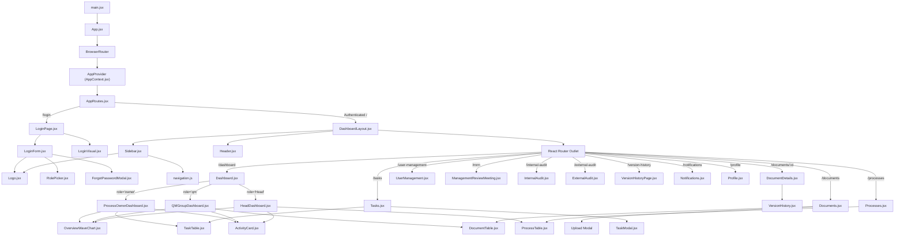

# C-DAC QMS Digitalization — React Component Hierarchy

> **Root Bootstrap File:** [`QMS-main/src/main.jsx`](file:///c:/Users/WBL/Downloads/QMS-main-updated/QMS-main/src/main.jsx)  
> **Root App Component:** [`QMS-main/src/App.jsx`](file:///c:/Users/WBL/Downloads/QMS-main-updated/QMS-main/src/App.jsx)  
> **Global State Context:** [`QMS-main/src/context/AppContext.jsx`](file:///c:/Users/WBL/Downloads/QMS-main-updated/QMS-main/src/context/AppContext.jsx)  

---

## 1. Complete Component Tree Hierarchy

```
<main.jsx> (DOM Mount at #root)
  └── <App.jsx>
        ├── <BrowserRouter> (React Router v6 Container)
        │     └── <AppProvider> (Global Context Provider - AppContext.jsx)
        │           └── <AppRoutes> (Routes Switcher - AppRoutes.jsx)
        │                 │
        │                 ├── Route "/login" ──► <LoginPage>
        │                 │                        ├── <LoginForm>
        │                 │                        │     ├── <Logo>
        │                 │                        │     ├── <RolePicker>
        │                 │                        │     └── <ForgotPasswordModal>
        │                 │                        └── <LoginVisual>
        │                 │
        │                 └── Route "/" ──► <DashboardLayout>
        │                                     ├── <Sidebar>
        │                                     │     ├── <Logo>
        │                                     │     └── <NavLink> (Role-filtered navigation items)
        │                                     ├── <Header>
        │                                     │     ├── Search Bar
        │                                     │     ├── Notification Bell & Counter
        │                                     │     └── User Profile Badge & Quick Menu
        │                                     │
        │                                     └── <Outlet> (Dynamic Route Resolution)
        │                                           │
        │                                           ├── Route "/dashboard" ──► <Dashboard>
        │                                           │                           ├── If role === "owner" ──► <ProcessOwnerDashboard>
        │                                           │                           │                             ├── <PageIntro>
        │                                           │                           │                             ├── <StatCard> (4 Grid Cards)
        │                                           │                           │                             ├── <OverviewWaveChart>
        │                                           │                           │                             ├── <TaskTable>
        │                                           │                           │                             └── <ActivityCard>
        │                                           │                           │
        │                                           │                           ├── If role === "Head" | "auditor" ──► <Head>
        │                                           │                           │                                        └── <HeadDashboard>
        │                                           │                           │                                              ├── <PageIntro>
        │                                           │                           │                                              ├── <StatCard> (4 Grid Cards)
        │                                           │                           │                                              ├── <OverviewWaveChart>
        │                                           │                           │                                              ├── <ProcessTable>
        │                                           │                           │                                              └── <ActivityCard>
        │                                           │                           │
        │                                           │                           └── If role === "qm" ──► <QMGroupDashboard>
        │                                           │                                                      ├── <PageIntro>
        │                                           │                                                      ├── <StatCard> (4 Grid Cards)
        │                                           │                                                      ├── <OverviewWaveChart>
        │                                           │                                                      ├── <DocumentTable>
        │                                           │                                                      └── <ActivityCard>
        │                                           │
        │                                           ├── Route "/documents" ──► <Documents>
        │                                           │                            ├── <PageIntro>
        │                                           │                            ├── Document Upload Modal (Form + File Picker)
        │                                           │                            ├── <DocumentTable>
        │                                           │                            │     └── <StatusBadge>
        │                                           │                            └── <EmptyState>
        │                                           │
        │                                           ├── Route "/documents/:id" ──► <DocumentDetails>
        │                                           │                                ├── <PageIntro>
        │                                           │                                ├── <StatusBadge>
        │                                           │                                ├── <Detail> (Metadata attributes)
        │                                           │                                ├── In-app Controlled Document Content Viewer
        │                                           │                                └── <VersionHistory> (Version list & upload modal)
        │                                           │
        │                                           ├── Route "/tasks" ──► <Tasks>
        │                                           │                        ├── <PageIntro>
        │                                           │                        ├── <TaskModal> (New task assignment modal)
        │                                           │                        │     └── <Modal> (Backdrop wrapper)
        │                                           │                        ├── <TaskTable>
        │                                           │                        │     └── Inline Status Selector
        │                                           │                        └── <EmptyState>
        │                                           │
        │                                           ├── Route "/processes" ──► <Processes>
        │                                           │                            ├── <PageIntro>
        │                                           │                            ├── <StatCard> (Process metrics)
        │                                           │                            ├── Process Cards & Progress Bars
        │                                           │                            └── <ProcessTable>
        │                                           │
        │                                           ├── Route "/user-management" ──► <UserManagement>
        │                                           │                                  ├── <PageIntro>
        │                                           │                                  ├── User Creation Modal Form
        │                                           │                                  ├── User Roster Table
        │                                           │                                  │     └── <StatusBadge>
        │                                           │                                  └── <EmptyState>
        │                                           │
        │                                           ├── Route "/mrm" ──► <ManagementReviewMeeting>
        │                                           │                      ├── <PageIntro>
        │                                           │                      ├── 4-Stage Workflow Stepper
        │                                           │                      │     ├── Stage 1: Plan & Agenda Modal
        │                                           │                      │     ├── Stage 2: Share Notice Confirmation Modal
        │                                           │                      │     ├── Stage 3: MoM Upload & File Picker Modal
        │                                           │                      │     └── Stage 4: Trust Head Approval / Changes Modal
        │                                           │                      ├── <StatCard> (Meeting statistics)
        │                                           │                      └── MRM Lifecycle Cards
        │                                           │
        │                                           ├── Route "/internal-audit" ──► <InternalAudit>
        │                                           │                                 ├── <PageIntro>
        │                                           │                                 ├── 7-Stage IQA Workflow Stepper
        │                                           │                                 │     ├── Stage 1: Plan Audit Schedule Modal
        │                                           │                                 │     ├── Stage 2: Share Schedule Modal
        │                                           │                                 │     ├── Stage 3: Auditee Confirmation Modal
        │                                           │                                 │     ├── Stage 4: Noticing Sheet Entry Modal
        │                                           │                                 │     ├── Stage 5: NC Documents Dispatch Modal
        │                                           │                                 │     ├── Stage 6: Auditee CAPA / RCA Modal
        │                                           │                                 │     └── Stage 7: Final Audit Closure Modal
        │                                           │                                 ├── <StatCard>
        │                                           │                                 └── Audit Cycle Cards
        │                                           │
        │                                           ├── Route "/external-audit" ──► <ExternalAudit>
        │                                           │                                 ├── <PageIntro>
        │                                           │                                 ├── 5-Step ISO 9001 Surveillance Stepper
        │                                           │                                 │     ├── Step 1: Log Incoming Email Modal
        │                                           │                                 │     ├── Step 2: Share Notice Modal
        │                                           │                                 │     ├── Step 3: Scanned Paper NC Upload Modal
        │                                           │                                 │     ├── Step 4: Resolution & Closure Modal
        │                                           │                                 │     └── Step 5: ISO 9001 Endorsement Modal
        │                                           │                                 ├── <StatCard>
        │                                           │                                 └── External Audit Cycle Cards
        │                                           │
        │                                           ├── Route "/version-history" ──► <VersionHistoryPage>
        │                                           │                                  ├── <PageIntro>
        │                                           │                                  ├── Workflow Overview Cards (IQA & External)
        │                                           │                                  ├── Filter Tabs (All, Internal, External, Activities)
        │                                           │                                  ├── Search Input Field
        │                                           │                                  └── Audit Trail Table (Events, Actors, Timestamps)
        │                                           │
        │                                           ├── Route "/notifications" ──► <Notifications>
        │                                           │                                ├── <PageIntro>
        │                                           │                                ├── Role Filters & "Mark all as read" button
        │                                           │                                └── Notification Item Cards
        │                                           │
        │                                           ├── Route "/reviews" ──► <Reviews>
        │                                           │                          ├── <PageIntro>
        │                                           │                          └── <DocumentTable> (Filtered by "Under Review")
        │                                           │
        │                                           └── Route "/profile" ──► <Profile>
        │                                                                      ├── <PageIntro>
        │                                                                      ├── User Avatar & Initials Badge
        │                                                                      ├── Institutional Identity & Privilege Tags
        │                                                                      └── Security & Active Session Cards
```

---

## 2. Mermaid Component Tree Diagram



---

## 3. State & Data Maintenance Mapping

All application state is centrally coordinated in [`AppContext.jsx`](file:///c:/Users/WBL/Downloads/QMS-main-updated/QMS-main/src/context/AppContext.jsx) using React Hooks (`useState`, `useEffect`, `useCallback`) and synchronized directly with the backend APIs:

| State Variable | Type | Initial Value | Synced From API Endpoint | Consuming Components |
|---|---|---|---|---|
| `currentUser` | Object | `localStorage.getItem("qms_user")` | `POST /api/auth/login`, `GET /api/auth/me` | `Sidebar`, `Header`, `Dashboard`, `Profile`, all pages |
| `token` | String | `localStorage.getItem("qms_token")` | `POST /api/auth/login` | Passed in headers to all authenticated API calls |
| `documents` | Array | `[]` | `GET /api/documents` | `Documents.jsx`, `DocumentDetails.jsx`, `QMGroupDashboard.jsx` |
| `tasks` | Array | `[]` | `GET /api/tasks` | `Tasks.jsx`, `ProcessOwnerDashboard.jsx`, `TaskTable.jsx` |
| `processes` | Array | `[]` | `GET /api/processes` | `Processes.jsx`, `HeadDashboard.jsx`, `ProcessTable.jsx` |
| `notifications` | Array | `[]` | `GET /api/notifications` | `Header.jsx`, `Sidebar.jsx`, `Notifications.jsx` |
| `usersList` | Array | `[]` | `GET /api/users` | `UserManagement.jsx`, `TaskModal.jsx` |
| `mrmList` | Array | `sortMRMs(...)` | `GET /api/mrm` | `ManagementReviewMeeting.jsx` |
| `auditList` | Array | `sortAudits(...)` | `GET /api/audit` | `InternalAudit.jsx`, `VersionHistoryPage.jsx` |
| `externalAuditList` | Array | `sortExternalAudits(...)` | `GET /api/external-audit` | `ExternalAudit.jsx`, `VersionHistoryPage.jsx` |
| `activities` | Array | `[]` | `GET /api/activities` | `ActivityCard.jsx`, `VersionHistoryPage.jsx` |
| `dashboardStats` | Object | `null` | `GET /api/dashboard/stats` | `OverviewWaveChart.jsx`, `HeadDashboard.jsx`, `QMGroupDashboard.jsx` |
| `employees` | Array | `[]` | `GET /api/employees` | `Processes.jsx`, `Tasks.jsx` |
