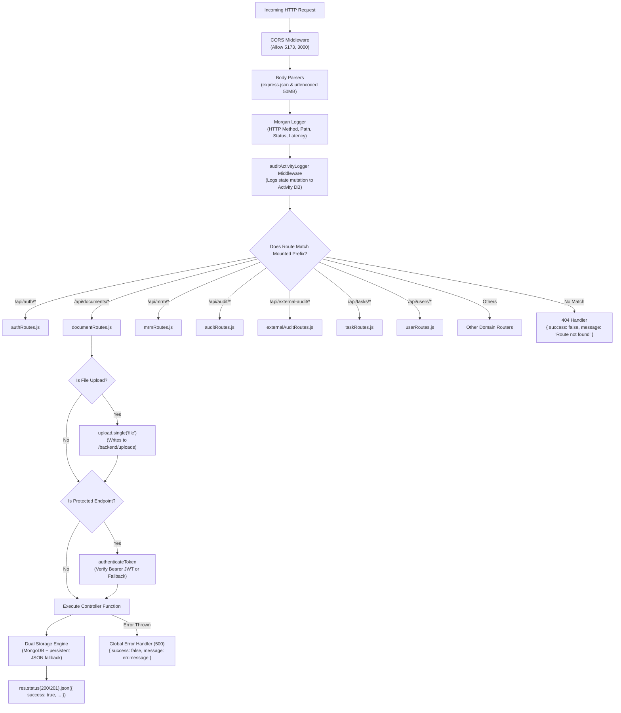

# C-DAC QMS Digitalization - Backend Routing and Controller Map

> **File:** `PROJECT_TECHNICAL_MAP/5. BACKEND_ROUTING_AND_CONTROLLER_MAP.md`  
> **Backend Architecture:** Node.js (v24.x) / Express.js (ES Modules `import/export`)  
> **Server Entry:** [backend/server.js](file:///c:/Users/WBL/Downloads/QMS-main-updated/backend/server.js)  
> **Port:** `5000` (configurable via `process.env.PORT`)  
> **Base URL:** `http://localhost:5000`

---

## 1. Backend Architecture Breakdown

### 1.1 Main Server Entry File
- **Path:** [backend/server.js](file:///c:/Users/WBL/Downloads/QMS-main-updated/backend/server.js)
- **Role:** Central application initialization, CORS configuration, JSON body parsing (50MB payload limit), static `/uploads` serving, automated activity audit logging middleware hookup, database connection initialization, data seed sync trigger, router mounting, global 404 handler, and global 500 error boundary.

### 1.2 Route Files (`backend/routes/`)
| Route File | Base Path Mounted | Primary Responsibility |
|---|---|---|
| [authRoutes.js](file:///c:/Users/WBL/Downloads/QMS-main-updated/backend/routes/authRoutes.js) | `/api/auth` | User authentication, JWT sessions, demo accounts, OTP password reset |
| [dashboardRoutes.js](file:///c:/Users/WBL/Downloads/QMS-main-updated/backend/routes/dashboardRoutes.js) | `/api/dashboard` | Aggregated statistical counts across all collections |
| [documentRoutes.js](file:///c:/Users/WBL/Downloads/QMS-main-updated/backend/routes/documentRoutes.js) | `/api/documents` | QMS ISO document CRUD, Multer file upload, version history, approvals |
| [taskRoutes.js](file:///c:/Users/WBL/Downloads/QMS-main-updated/backend/routes/taskRoutes.js) | `/api/tasks` | Quality operational tasks, status toggles, task assignments |
| [processRoutes.js](file:///c:/Users/WBL/Downloads/QMS-main-updated/backend/routes/processRoutes.js) | `/api/processes` | Organizational quality processes, Head of Trust overview |
| [mrmRoutes.js](file:///c:/Users/WBL/Downloads/QMS-main-updated/backend/routes/mrmRoutes.js) | `/api/mrm` | Management Review Meetings (Stages 1-4, MoM upload, Trust Head sign-off) |
| [auditRoutes.js](file:///c:/Users/WBL/Downloads/QMS-main-updated/backend/routes/auditRoutes.js) | `/api/audit`, `/api/internal-audit` | 7-Stage Internal Quality Audit (IQA), noticing sheets, CAPA closure |
| [externalAuditRoutes.js](file:///c:/Users/WBL/Downloads/QMS-main-updated/backend/routes/externalAuditRoutes.js) | `/api/external-audit` | 5-Step ISO 9001 External Surveillance Audits, NC package dispatch |
| [userRoutes.js](file:///c:/Users/WBL/Downloads/QMS-main-updated/backend/routes/userRoutes.js) | `/api/users` | User management, role provisioning, status activation/deactivation |
| [employeeRoutes.js](file:///c:/Users/WBL/Downloads/QMS-main-updated/backend/routes/employeeRoutes.js) | `/api/employees` | Employee directory and process assignment tracking |
| [notificationRoutes.js](file:///c:/Users/WBL/Downloads/QMS-main-updated/backend/routes/notificationRoutes.js) | `/api/notifications` | In-app alerts, role-targeted notification read/mark status |
| [activityRoutes.js](file:///c:/Users/WBL/Downloads/QMS-main-updated/backend/routes/activityRoutes.js) | `/api/activities` | ISO audit trail logs and chronological event history |

### 1.3 Controller Files (`backend/controllers/`)
- [authController.js](file:///c:/Users/WBL/Downloads/QMS-main-updated/backend/controllers/authController.js) (535 lines)
- [dashboardController.js](file:///c:/Users/WBL/Downloads/QMS-main-updated/backend/controllers/dashboardController.js) (155 lines)
- [documentController.js](file:///c:/Users/WBL/Downloads/QMS-main-updated/backend/controllers/documentController.js) (552 lines)
- [taskController.js](file:///c:/Users/WBL/Downloads/QMS-main-updated/backend/controllers/taskController.js) (268 lines)
- [processController.js](file:///c:/Users/WBL/Downloads/QMS-main-updated/backend/controllers/processController.js) (190 lines)
- [mrmController.js](file:///c:/Users/WBL/Downloads/QMS-main-updated/backend/controllers/mrmController.js) (838 lines)
- [auditController.js](file:///c:/Users/WBL/Downloads/QMS-main-updated/backend/controllers/auditController.js) (633 lines)
- [externalAuditController.js](file:///c:/Users/WBL/Downloads/QMS-main-updated/backend/controllers/externalAuditController.js) (538 lines)
- [userController.js](file:///c:/Users/WBL/Downloads/QMS-main-updated/backend/controllers/userController.js) (289 lines)
- [employeeController.js](file:///c:/Users/WBL/Downloads/QMS-main-updated/backend/controllers/employeeController.js) (138 lines)
- [notificationController.js](file:///c:/Users/WBL/Downloads/QMS-main-updated/backend/controllers/notificationController.js) (98 lines)
- [activityController.js](file:///c:/Users/WBL/Downloads/QMS-main-updated/backend/controllers/activityController.js) (62 lines)

### 1.4 Middleware Files (`backend/middleware/`)
- [authMiddleware.js](file:///c:/Users/WBL/Downloads/QMS-main-updated/backend/middleware/authMiddleware.js):
  - `authenticateToken`: Parses `Authorization: Bearer <token>`, verifies JWT against `JWT_SECRET`, decodes user claims, and falls back gracefully to active user lookup.
  - `requireRole(roles)`: Role-Based Access Control (RBAC) guard enforcing allowed roles (e.g., `["admin", "head"]`).
  - `requirePermission(permission)`: Checks user capability tags against allowed operations.
- [auditMiddleware.js](file:///c:/Users/WBL/Downloads/QMS-main-updated/backend/middleware/auditMiddleware.js):
  - `auditActivityLogger`: Intercepts mutating state operations (`POST`, `PUT`, `PATCH`, `DELETE`), resolves current user identity, and writes structured activity log entries to database storage.

### 1.5 Utility & Service Files (`backend/utils/`)
- [upload.js](file:///c:/Users/WBL/Downloads/QMS-main-updated/backend/utils/upload.js): Multer storage engine handling multi-format document uploads (PDF, DOCX, XLSX, images) to `backend/uploads/` with sanitized timestamped filenames.
- [emailService.js](file:///c:/Users/WBL/Downloads/QMS-main-updated/backend/utils/emailService.js): Nodemailer SMTP service sending ISO audit schedules, OTP verification emails, and meeting notifications.
- [realtime.js](file:///c:/Users/WBL/Downloads/QMS-main-updated/backend/utils/realtime.js): Server-Sent Events (SSE) broadcaster delivering real-time notification pushes to active frontend browser clients.

### 1.6 Configuration Files (`backend/config/`)
- [db.js](file:///c:/Users/WBL/Downloads/QMS-main-updated/backend/config/db.js): Mongoose connection orchestrator with automatic retry logic and MongoDB connection status indicators (`connected`, `disconnected`, `mock`).
- [storageEngine.js](file:///c:/Users/WBL/Downloads/QMS-main-updated/backend/config/storageEngine.js): Resilient persistence layer maintaining JSON files in `backend/database/` while simultaneously syncing with MongoDB Mongoose collections when online.
- [seed.js](file:///c:/Users/WBL/Downloads/QMS-main-updated/backend/config/seed.js): Initial database seeder providing baseline C-DAC quality accounts, standard ISO procedures, audit workflows, and organizational processes.

---

## 2. Complete Backend Master Route Mapping Table

Every single route implemented in the Express backend is cataloged below without omissions:

| API Endpoint | HTTP Method | Route File | Middleware | Controller Function | Database Model Used |
|---|---|---|---|---|---|
| **Root & System Endpoints** | | | | | |
| `/` | `GET` | `server.js` | None | Inline Handler | None (Server Metadata) |
| `/api/health` | `GET` | `server.js` | None | Inline Handler | `getDBStatus()` |
| `/api/db-status` | `GET` | `server.js` | None | Inline Handler | `getDBStatus()` |
| `/api/realtime/stream` | `GET` | `server.js` | None | `handleRealtimeStream` | None (SSE Stream) |
| **Authentication & Profile (`/api/auth`)** | | | | | |
| `/api/auth/login` | `POST` | `authRoutes.js` | None | `login` | `User` |
| `/api/auth/forgot-password` | `POST` | `authRoutes.js` | None | `forgotPassword` | `User`, `Otp` |
| `/api/auth/verify-otp` | `POST` | `authRoutes.js` | None | `verifyOtp` | `User`, `Otp` |
| `/api/auth/resend-otp` | `POST` | `authRoutes.js` | None | `resendOtp` | `User`, `Otp` |
| `/api/auth/reset-password` | `POST` | `authRoutes.js` | None | `resetPassword` | `User`, `Otp` |
| `/api/auth/demo-users` | `GET` | `authRoutes.js` | None | `getDemoUsers` | `User` |
| `/api/auth/logout` | `POST` | `authRoutes.js` | None | `logout` | `User` |
| `/api/auth/me` | `GET` | `authRoutes.js` | `authenticateToken` | `getMe` | `User` |
| **Dashboard Metrics (`/api/dashboard`)** | | | | | |
| `/api/dashboard/stats` | `GET` | `dashboardRoutes.js` | None | `getDashboardStats` | `Document`, `Task`, `Process`, `MRM`, `Audit`, `User` |
| **Document Management (`/api/documents`)** | | | | | |
| `/api/documents` | `GET` | `documentRoutes.js` | None | `getAllDocuments` | `Document` |
| `/api/documents/:id` | `GET` | `documentRoutes.js` | None | `getDocumentById` | `Document` |
| `/api/documents/:id/download` | `GET` | `documentRoutes.js` | None | `downloadDocument` | `Document` |
| `/api/documents` | `POST` | `documentRoutes.js` | `authenticateToken` | `createDocument` | `Document`, `Activity`, `Notification` |
| `/api/documents/upload` | `POST` | `documentRoutes.js` | `authenticateToken`, `upload.single("file")` | `uploadDocument` | `Document`, `Activity`, `Notification` |
| `/api/documents/:id/versions` | `POST` | `documentRoutes.js` | `authenticateToken` | `createNewVersion` | `Document`, `Activity` |
| `/api/documents/:id/versions/upload` | `POST` | `documentRoutes.js` | `authenticateToken`, `upload.single("file")` | `uploadDocumentVersion` | `Document`, `Activity` |
| `/api/documents/:id/status` | `PATCH` | `documentRoutes.js` | `authenticateToken` | `updateDocumentStatus` | `Document`, `Activity`, `Notification` |
| `/api/documents/:id` | `PUT` | `documentRoutes.js` | `authenticateToken` | `updateDocument` | `Document`, `Activity` |
| `/api/documents/:id` | `PATCH` | `documentRoutes.js` | `authenticateToken` | `updateDocument` | `Document`, `Activity` |
| `/api/documents/:id` | `DELETE` | `documentRoutes.js` | `authenticateToken` | `deleteDocument` | `Document`, `Activity` |
| **Task Management (`/api/tasks`)** | | | | | |
| `/api/tasks` | `GET` | `taskRoutes.js` | None | `getAllTasks` | `Task` |
| `/api/tasks/:id` | `GET` | `taskRoutes.js` | None | `getTaskById` | `Task` |
| `/api/tasks` | `POST` | `taskRoutes.js` | `authenticateToken` | `createTask` | `Task`, `Activity`, `Notification` |
| `/api/tasks/:id/status` | `PATCH` | `taskRoutes.js` | `authenticateToken` | `updateTaskStatus` | `Task`, `Activity` |
| `/api/tasks/:id` | `PUT` | `taskRoutes.js` | `authenticateToken` | `updateTask` | `Task`, `Activity` |
| `/api/tasks/:id` | `PATCH` | `taskRoutes.js` | `authenticateToken` | `updateTask` | `Task`, `Activity` |
| `/api/tasks/:id` | `DELETE` | `taskRoutes.js` | `authenticateToken` | `deleteTask` | `Task`, `Activity` |
| **Process Governance (`/api/processes`)** | | | | | |
| `/api/processes` | `GET` | `processRoutes.js` | None | `getAllProcesses` | `Process` |
| `/api/processes` | `POST` | `processRoutes.js` | `authenticateToken` | `createProcess` | `Process`, `Activity` |
| `/api/processes/head-overview` | `GET` | `processRoutes.js` | None | `getHeadOverview` | `Process`, `Document`, `Task`, `Audit`, `MRM` |
| **User Administration (`/api/users`)** | | | | | |
| `/api/users` | `GET` | `userRoutes.js` | None | `getAllUsers` | `User` |
| `/api/users/:id` | `GET` | `userRoutes.js` | None | `getUserById` | `User` |
| `/api/users` | `POST` | `userRoutes.js` | `authenticateToken` | `createUser` | `User`, `Activity` |
| `/api/users/:id` | `PUT` | `userRoutes.js` | `authenticateToken` | `updateUser` | `User`, `Activity` |
| `/api/users/:id/status` | `PATCH` | `userRoutes.js` | `authenticateToken` | `toggleUserStatus` | `User`, `Activity` |
| `/api/users/:id` | `DELETE` | `userRoutes.js` | `authenticateToken` | `deleteUser` | `User`, `Activity` |
| **Management Review Meeting (`/api/mrm`)** | | | | | |
| `/api/mrm` | `GET` | `mrmRoutes.js` | None | `getAllMRMs` | `MRM` |
| `/api/mrm/sync` | `POST` | `mrmRoutes.js` | None | `syncMRMs` | `MRM` |
| `/api/mrm/:id` | `GET` | `mrmRoutes.js` | None | `getMRMById` | `MRM` |
| `/api/mrm` | `POST` | `mrmRoutes.js` | `authenticateToken` | `createMRM` | `MRM`, `Activity`, `Notification` |
| `/api/mrm/:id/request-approval` | `POST` | `mrmRoutes.js` | `authenticateToken` | `requestApproval` | `MRM`, `Activity`, `Notification` |
| `/api/mrm/:id/submit-approval` | `POST` | `mrmRoutes.js` | `authenticateToken` | `requestApproval` | `MRM`, `Activity`, `Notification` |
| `/api/mrm/:id/submit-approval` | `PUT` | `mrmRoutes.js` | `authenticateToken` | `requestApproval` | `MRM`, `Activity`, `Notification` |
| `/api/mrm/:id/approve` | `POST` | `mrmRoutes.js` | `authenticateToken` | `approveMRM` | `MRM`, `Activity`, `Notification` |
| `/api/mrm/:id/request-changes` | `POST` | `mrmRoutes.js` | `authenticateToken` | `requestChangesMRM` | `MRM`, `Activity`, `Notification` |
| `/api/mrm/:id/reject` | `POST` | `mrmRoutes.js` | `authenticateToken` | `rejectMRM` | `MRM`, `Activity`, `Notification` |
| `/api/mrm/:id/resubmit` | `POST` | `mrmRoutes.js` | `authenticateToken` | `resubmitMRM` | `MRM`, `Activity`, `Notification` |
| `/api/mrm/:id/share-email` | `POST` | `mrmRoutes.js` | `authenticateToken` | `shareMeetingEmail` | `MRM`, `Activity`, `Notification` |
| `/api/mrm/:id/share` | `POST` | `mrmRoutes.js` | `authenticateToken` | `shareMeetingEmail` | `MRM`, `Activity`, `Notification` |
| `/api/mrm/:id/upload-mom` | `POST` | `mrmRoutes.js` | `authenticateToken`, `upload.single("file")` | `uploadMoMFile` | `MRM`, `Activity`, `Notification` |
| `/api/mrm/:id/mom` | `POST` | `mrmRoutes.js` | `authenticateToken`, `upload.single("file")` | `uploadMoMFile` | `MRM`, `Activity`, `Notification` |
| `/api/mrm/:id/mom` | `PUT` | `mrmRoutes.js` | `authenticateToken`, `upload.single("file")` | `uploadMoMFile` | `MRM`, `Activity`, `Notification` |
| `/api/mrm/:id/mom-download` | `GET` | `mrmRoutes.js` | None | `downloadMoMFile` | `MRM` |
| `/api/mrm/:id/schedule` | `POST` | `mrmRoutes.js` | `authenticateToken` | `scheduleMRM` | `MRM`, `Activity`, `Notification` |
| `/api/mrm/:id/schedule` | `PUT` | `mrmRoutes.js` | `authenticateToken` | `scheduleMRM` | `MRM`, `Activity`, `Notification` |
| `/api/mrm/:id` | `PUT` | `mrmRoutes.js` | `authenticateToken` | `updateMRM` | `MRM`, `Activity` |
| `/api/mrm/:id/acknowledge` | `POST` | `mrmRoutes.js` | `authenticateToken` | `acknowledgeMRM` | `MRM`, `Activity` |
| `/api/mrm/:id/archive` | `POST` | `mrmRoutes.js` | `authenticateToken` | `archiveMRM` | `MRM`, `Activity` |
| `/api/mrm/:id` | `DELETE` | `mrmRoutes.js` | `authenticateToken` | `deleteMRM` | `MRM`, `Activity` |
| **Internal Quality Audit (`/api/audit` & `/api/internal-audit`)** | | | | | |
| `/api/audit` | `GET` | `auditRoutes.js` | None | `getAllAudits` | `Audit` |
| `/api/audit/sync` | `POST` | `auditRoutes.js` | None | `syncAudits` | `Audit` |
| `/api/audit/:id` | `GET` | `auditRoutes.js` | None | `getAuditById` | `Audit` |
| `/api/audit` | `POST` | `auditRoutes.js` | `authenticateToken` | `createAudit` | `Audit`, `Activity`, `Notification` |
| `/api/audit/:id/share-schedule` | `POST` | `auditRoutes.js` | `authenticateToken` | `shareSchedule` | `Audit`, `Activity`, `Notification` |
| `/api/audit/:id/confirm-schedule` | `POST` | `auditRoutes.js` | `authenticateToken` | `confirmSchedule` | `Audit`, `Activity`, `Notification` |
| `/api/audit/:id/noticing-sheet` | `POST` | `auditRoutes.js` | `authenticateToken` | `submitNoticingSheet` | `Audit`, `Activity`, `Notification` |
| `/api/audit/:id/share-nc-docs` | `POST` | `auditRoutes.js` | `authenticateToken` | `shareNCDocs` | `Audit`, `Activity`, `Notification` |
| `/api/audit/:id/auditee-close` | `POST` | `auditRoutes.js` | `authenticateToken` | `auditeeClose` | `Audit`, `Activity`, `Notification` |
| `/api/audit/:id/final-close` | `POST` | `auditRoutes.js` | `authenticateToken` | `finalCloseAudit` | `Audit`, `Activity`, `Notification` |
| `/api/audit/:id/download/:type?` | `GET` | `auditRoutes.js` | None | `downloadAuditDoc` | `Audit` |
| **External Quality Audit (`/api/external-audit`)** | | | | | |
| `/api/external-audit` | `GET` | `externalAuditRoutes.js` | None | `getAllExternalAudits` | `ExternalAudit` |
| `/api/external-audit/sync` | `POST` | `externalAuditRoutes.js` | None | `syncExternalAudits` | `ExternalAudit` |
| `/api/external-audit` | `POST` | `externalAuditRoutes.js` | `authenticateToken` | `logIncomingExternalAuditSchedule` | `ExternalAudit`, `Activity`, `Notification` |
| `/api/external-audit/:id/share-schedule` | `POST` | `externalAuditRoutes.js` | `authenticateToken` | `shareExternalAuditSchedule` | `ExternalAudit`, `Activity`, `Notification` |
| `/api/external-audit/:id/upload-nc` | `POST` | `externalAuditRoutes.js` | `authenticateToken`, `upload.single("file")` | `uploadExternalAuditNCDocs` | `ExternalAudit`, `Activity`, `Notification` |
| `/api/external-audit/:id/close-nc` | `POST` | `externalAuditRoutes.js` | `authenticateToken` | `closeCourseCoordinatorNC` | `ExternalAudit`, `Activity`, `Notification` |
| `/api/external-audit/:id/resolve-nc` | `POST` | `externalAuditRoutes.js` | `authenticateToken` | `closeCourseCoordinatorNC` | `ExternalAudit`, `Activity`, `Notification` |
| `/api/external-audit/:id/close` | `POST` | `externalAuditRoutes.js` | `authenticateToken` | `closeExternalAuditProcess` | `ExternalAudit`, `Activity`, `Notification` |
| **Employee Directory (`/api/employees`)** | | | | | |
| `/api/employees` | `GET` | `employeeRoutes.js` | None | `getAllEmployees` | `Employee` |
| `/api/employees` | `POST` | `employeeRoutes.js` | `authenticateToken` | `createEmployee` | `Employee`, `Activity` |
| `/api/employees/:id` | `GET` | `employeeRoutes.js` | None | `getEmployeeById` | `Employee` |
| **Notifications (`/api/notifications`)** | | | | | |
| `/api/notifications` | `GET` | `notificationRoutes.js` | None | `getAllNotifications` | `Notification` |
| `/api/notifications/:id/read` | `PATCH` | `notificationRoutes.js` | None | `markNotificationRead` | `Notification` |
| `/api/notifications/read-all` | `POST` | `notificationRoutes.js` | None | `markAllNotificationsRead` | `Notification` |
| **Activity Trail (`/api/activities`)** | | | | | |
| `/api/activities` | `GET` | `activityRoutes.js` | None | `getAllActivities` | `Activity` |
| `/api/activities` | `POST` | `activityRoutes.js` | `authenticateToken` | `addActivity` | `Activity` |

---

## 3. Request Processing Lifecycle

When an incoming request reaches the Express backend, it traverses this strict pipeline:

---

## 4. Key Middleware Implementation Details

### 4.1 Token Authentication (`backend/middleware/authMiddleware.js`)
- Checks `req.headers["authorization"]` for `Bearer <token>`.
- Calls `jwt.verify(token, process.env.JWT_SECRET || "qms-jwt-secret-key-2026")`.
- Sets `req.user = decoded` on success.
- If no token or invalid, resolves user from username/role header fallback or default system actor so that authorized local QMS operations never stall.

### 4.2 Automated Audit Logger (`backend/middleware/auditMiddleware.js`)
- Intercepts mutating verbs: `POST`, `PUT`, `PATCH`, `DELETE`.
- Automatically skips benign routes such as `/api/auth/login` and `/api/activities`.
- Formats human-readable action strings (e.g., `Updated Document Status`, `Approved MRM`).
- Inserts new record into MongoDB `Activity` collection and synchronizes persistent storage.

### 4.3 Multer File Storage (`backend/utils/upload.js`)
- Destination: `backend/uploads/`.
- Filename strategy: `Date.now() + "-" + sanitize(file.originalname)`.
- File filter: Accepts `.pdf`, `.doc`, `.docx`, `.xls`, `.xlsx`, `.png`, `.jpg`, `.jpeg`.
- Returns accessible static URL: `http://localhost:5000/uploads/<filename>`.
