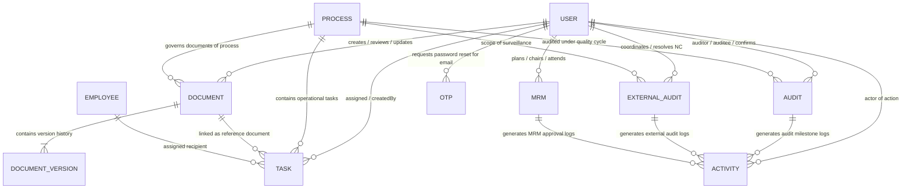

# C-DAC QMS Digitalization - Database and Mongoose Schemas Mapping

> **File:** `PROJECT_TECHNICAL_MAP/6. DATABASE_MAPPING.md`  
> **Database Engine:** MongoDB (via Mongoose ODM) with Dual Persistence Sync Engine  
> **Connection File:** [backend/config/db.js](file:///c:/Users/WBL/Downloads/QMS-main-updated/backend/config/db.js)  
> **Sync Engine:** [backend/config/storageEngine.js](file:///c:/Users/WBL/Downloads/QMS-main-updated/backend/config/storageEngine.js)  
> **Seed Engine:** [backend/config/seed.js](file:///c:/Users/WBL/Downloads/QMS-main-updated/backend/config/seed.js)

---

## 1. Entity Relationship Diagram (ERD)

The following Mermaid diagram maps the **actual implemented relationships and functional references** between collections in the QMS codebase:

---

## 2. Comprehensive Model & Schema Specifications

### 2.1 Model: `User`
- **Model File:** [backend/models/User.js](file:///c:/Users/WBL/Downloads/QMS-main-updated/backend/models/User.js)
- **MongoDB Collection:** `users`
- **Mongoose Model Name:** `User`

| Field Name | Type | Required | Default | Modifiers / Constraints | Description |
|---|---|---|---|---|---|
| `id` | String | **Yes** | — | `unique: true` | Application user identifier (e.g., `user-head`, `user-coord`) |
| `username` | String | **Yes** | — | `unique: true, lowercase: true, trim: true` | System login handle (e.g., `head`, `coursecoordinator`) |
| `email` | String | **Yes** | — | `unique: true, lowercase: true, trim: true` | Official CDAC email address |
| `employeeId` | String | **Yes** | — | `unique: true, uppercase: true, trim: true` | Employee ID badge number (e.g., `CDAC-001`) |
| `password` | String | **Yes** | — | Hashed with bcrypt | Encrypted credentials |
| `name` | String | **Yes** | — | `trim: true` | Full legal or display name |
| `role` | String | **Yes** | — | Values: `head`, `coordinator`, `owner`, `admin`, `auditor` | Primary RBAC role identifier |
| `roleTitle` | String | **Yes** | — | — | Human-readable role label (e.g. `Head of Trust`, `QMS Coordinator`) |
| `initials` | String | No | — | — | Avatar initials (e.g. `HT`, `QC`, `CC`) |
| `department` | String | No | `"Quality Management"` | — | Division assignment |
| `process` | String | No | `"All Processes"` | — | Scoped process (e.g., `Training and Course Execution`) |
| `designation` | String | No | — | — | Professional title (e.g., `Senior Director`, `Scientist E`) |
| `status` | String | No | `"Active"` | Values: `Active`, `Inactive`, `Suspended` | Account access toggle |
| `joinDate` | String | No | — | — | ISO joining date |
| `aliases` | `[String]` | No | `[]` | — | Alternative usernames accepted during login |
| `privileges` | `[String]` | No | `[]` | — | Granted permission strings |
| `createdAt` | Date | Auto | — | `timestamps: true` | MongoDB record creation timestamp |
| `updatedAt` | Date | Auto | — | `timestamps: true` | MongoDB record last modification timestamp |

- **Controllers Utilizing Model:** [backend/controllers/authController.js](file:///c:/Users/WBL/Downloads/QMS-main-updated/backend/controllers/authController.js), [backend/controllers/userController.js](file:///c:/Users/WBL/Downloads/QMS-main-updated/backend/controllers/userController.js), [backend/controllers/dashboardController.js](file:///c:/Users/WBL/Downloads/QMS-main-updated/backend/controllers/dashboardController.js)
- **Associated Endpoints:** `POST /api/auth/login`, `POST /api/auth/forgot-password`, `POST /api/auth/reset-password`, `GET /api/auth/me`, `GET /api/users`, `POST /api/users`, `PUT /api/users/:id`, `PATCH /api/users/:id/status`, `DELETE /api/users/:id`
- **Frontend Modules Displaying Data:** `Login.jsx`, `UserManagement.jsx`, `Navbar.jsx`, `Sidebar.jsx`, `Dashboard.jsx`.

---

### 2.2 Model: `Document`
- **Model File:** [backend/models/Document.js](file:///c:/Users/WBL/Downloads/QMS-main-updated/backend/models/Document.js)
- **MongoDB Collection:** `documents`
- **Mongoose Model Name:** `Document`

| Field Name | Type | Required | Default | Modifiers / Constraints | Description |
|---|---|---|---|---|---|
| `id` | String | **Yes** | — | `unique: true` | Document identifier (e.g., `DOC-001`) |
| `name` | String | **Yes** | — | Synced with `title` | Document title / filename representation |
| `title` | String | No | — | Synced with `name` | Human-readable document name |
| `code` | String | No | — | — | Quality procedure code (e.g., `QP-TRG-01`) |
| `type` | String | **Yes** | `"Procedures"` | Values: `Manual`, `Procedures`, `Formats`, `Records` | QMS ISO Document classification |
| `process` | String | **Yes** | — | — | Associated quality process |
| `owner` | String | **Yes** | `"Course Coordinator"` | — | Process owner responsible for maintenance |
| `version` | String | No | `"1.0"` | Synced with `currentVersion` | Active document revision version |
| `currentVersion`| String | No | — | Synced with `version` | Alias for active version |
| `updated` | String | No | — | — | Human-formatted last modified date |
| `updatedBy` | String | No | — | — | Username or role of last modifier |
| `status` | String | No | `"Under Review"` | Values: `Draft`, `Under Review`, `Approved`, `Rejected`, `Obsolete` | Workflow approval state |
| `submittedBy` | String | No | — | — | Initiator of review workflow |
| `reviewComments`| String | No | — | — | Trust Head or Auditor remarks |
| `description` | String | No | — | — | Summary of procedure or manual |
| `content` | String | No | — | — | Text content or rich body |
| `fileUrl` | String | No | `""` | Served from `/uploads/*` | Static file URL path on backend |
| `fileName` | String | No | `""` | Sanitized disk name | Physical disk filename |
| `originalName` | String | No | `""` | Client upload name | Original uploaded file name |
| `fileSize` | String | No | `""` | — | Human-readable file size (e.g. `2.4 MB`) |
| `mimeType` | String | No | `""` | — | MIME string (e.g. `application/pdf`) |
| `storagePath` | String | No | `""` | — | Absolute filesystem storage path |
| `versions` | `[versionSchema]` | No | `[]` | Embedded Subdocument | Revision log: version number, author, date, file URL, change notes |
| `metadata` | Mixed | No | `{}` | — | Additional extensible ISO tags |

- **Subdocument: `versionSchema` (`backend/models/Document.js` lines 3-17)**:
  - `version`: String (required)
  - `date`: String
  - `author`: String
  - `uploadedBy`: String
  - `status`: String (default: `"Current"`)
  - `notes`: String
  - `changeLog`: String
  - `fileUrl`: String
  - `fileSize`: String

- **Controllers Utilizing Model:** [backend/controllers/documentController.js](file:///c:/Users/WBL/Downloads/QMS-main-updated/backend/controllers/documentController.js), [backend/controllers/dashboardController.js](file:///c:/Users/WBL/Downloads/QMS-main-updated/backend/controllers/dashboardController.js), [backend/controllers/processController.js](file:///c:/Users/WBL/Downloads/QMS-main-updated/backend/controllers/processController.js)
- **Associated Endpoints:** `GET /api/documents`, `GET /api/documents/:id`, `GET /api/documents/:id/download`, `POST /api/documents`, `POST /api/documents/upload`, `POST /api/documents/:id/versions`, `POST /api/documents/:id/versions/upload`, `PATCH /api/documents/:id/status`, `PUT /api/documents/:id`, `DELETE /api/documents/:id`
- **Frontend Modules Displaying Data:** `DocumentManagement.jsx`, `TaskManagement.jsx`, `VersionHistory.jsx`, `HeadOverview.jsx`, `Dashboard.jsx`.

---

### 2.3 Model: `Task`
- **Model File:** [backend/models/Task.js](file:///c:/Users/WBL/Downloads/QMS-main-updated/backend/models/Task.js)
- **MongoDB Collection:** `tasks`
- **Mongoose Model Name:** `Task`

| Field Name | Type | Required | Default | Description |
|---|---|---|---|---|
| `id` | String | **Yes** | — | Unique task code (e.g., `TSK-001`) |
| `title` | String | **Yes** | — | Task title / requirement summary |
| `description` | String | No | — | Detailed assignment instructions |
| `employee` | String | **Yes** | — | Assigned employee name or handle |
| `assignedTo` | String | No | — | Synced with `employee` |
| `assignedBy` | String | No | — | Assigning officer (e.g., QMS Coordinator) |
| `process` | String | No | — | Scoped quality process name |
| `document` | String | No | — | Associated document reference |
| `assigned` | String | No | — | Date assigned |
| `due` | String | No | — | Due date string |
| `dueDate` | String | No | — | Synced with `due` |
| `priority` | String | No | `"Medium"` | Values: `High`, `Medium`, `Low` |
| `status` | String | No | `"Pending"` | Values: `Pending`, `In Progress`, `Completed`, `Overdue` |
| `category` | String | No | `"General"` | Operational task classification |

- **Controllers Utilizing Model:** [backend/controllers/taskController.js](file:///c:/Users/WBL/Downloads/QMS-main-updated/backend/controllers/taskController.js), [backend/controllers/dashboardController.js](file:///c:/Users/WBL/Downloads/QMS-main-updated/backend/controllers/dashboardController.js)
- **Associated Endpoints:** `GET /api/tasks`, `GET /api/tasks/:id`, `POST /api/tasks`, `PATCH /api/tasks/:id/status`, `PUT /api/tasks/:id`, `DELETE /api/tasks/:id`
- **Frontend Modules Displaying Data:** `TaskManagement.jsx`, `Dashboard.jsx`.

---

### 2.4 Model: `Process`
- **Model File:** [backend/models/Process.js](file:///c:/Users/WBL/Downloads/QMS-main-updated/backend/models/Process.js)
- **MongoDB Collection:** `processes`
- **Mongoose Model Name:** `Process`

| Field Name | Type | Required | Default | Description |
|---|---|---|---|---|
| `id` | String | **Yes** | — | Process identifier (e.g., `PROC-001`) |
| `name` | String | **Yes** | — | Process title (e.g., `Training and Course Execution`) |
| `code` | String | No | — | Process acronym/code |
| `owner` | String | **Yes** | — | Process owner title (e.g., `Course Coordinator`) |
| `department` | String | No | — | Parent department |
| `employees` | Number | No | `0` | Count of employees enrolled |
| `active` | Number | No | `0` | Active task count |
| `completed` | Number | No | `0` | Completed task count |
| `pending` | Number | No | `0` | Pending task count |
| `documents` | Number | No | `0` | Governed document count |
| `status` | String | No | `"Active"` | Operational status |
| `progress` | Number | No | `0` | Percentage completion (0-100) |
| `complianceScore` | Number | No | `100` | Process ISO compliance rating (0-100) |
| `target` | String | No | — | Quality objective target |
| `description` | String | No | — | ISO process scope statement |
| `lastAuditDate` | String | No | — | Date of last audit cycle |

- **Controllers Utilizing Model:** [backend/controllers/processController.js](file:///c:/Users/WBL/Downloads/QMS-main-updated/backend/controllers/processController.js), [backend/controllers/dashboardController.js](file:///c:/Users/WBL/Downloads/QMS-main-updated/backend/controllers/dashboardController.js)
- **Associated Endpoints:** `GET /api/processes`, `POST /api/processes`, `GET /api/processes/head-overview`
- **Frontend Modules Displaying Data:** `ProcessTasks.jsx`, `Processes.jsx`, `HeadOverview.jsx`, `Dashboard.jsx`.

---

### 2.5 Model: `MRM` (Management Review Meeting)
- **Model File:** [backend/models/MRM.js](file:///c:/Users/WBL/Downloads/QMS-main-updated/backend/models/MRM.js)
- **MongoDB Collection:** `mrms`
- **Mongoose Model Name:** `MRM`

| Field Name | Type | Required | Default | Description |
|---|---|---|---|---|
| `id` | String | **Yes** | — | MRM ID (e.g., `MRM-2026-Q1`) |
| `title` | String | **Yes** | — | Meeting subject / title |
| `description` | String | No | — | Agenda overview |
| `version` | String | No | `"1.0"` | MRM document revision |
| `versionHistory` | `[Mixed]` | No | `[]` | Revision log entries |
| `status` | String | No | `"Scheduled"` | Values: `Scheduled`, `Under Review`, `Approved`, `Changes Requested`, `Completed` |
| `stage` | Number | No | `1` | Workflow Stage: 1 (Schedule), 2 (Agenda/Review), 3 (MoM Upload), 4 (Sign-off) |
| `process` | String | No | — | Scoped process |
| `targetMonth` | String | No | — | Target operational month |
| `scheduledDate` | String | **Yes** | — | ISO date of meeting |
| `scheduledTime` | String | **Yes** | — | Time of meeting |
| `venue` | String | No | `"Executive Boardroom..."` | Physical room or online conference link |
| `plannedBy` | String | No | `"QMS Coordinator"` | Officer who initiated scheduling |
| `chairperson` | String | No | `"Trust Head"` | Review authority |
| `coordinator` | String | No | `"QMS Coordinator"` | Facilitator |
| `approvalStatus` | String | No | `"Pending"` | Values: `Pending`, `Approved`, `Changes Requested`, `Rejected` |
| `agenda` | `[String]` | No | `[]` | List of ISO discussion points |
| `attendees` | `[Mixed]` | No | `[]` | Participant roster (name, role, status) |
| `approvals` | Mixed | No | — | Formal sign-off records with comments and timestamps |
| `mom` | Mixed | No | `null` | Minutes of Meeting textual contents and decisions |
| `momFileUrl` | String | No | `""` | File URL to uploaded signed MoM document |
| `momFileName` | String | No | `""` | Disk filename of MoM document |
| `momFileSize` | String | No | `""` | File size of MoM attachment |
| `timeline` | `[Mixed]` | No | `[]` | Chronological audit trail of meeting events |

- **Controllers Utilizing Model:** [backend/controllers/mrmController.js](file:///c:/Users/WBL/Downloads/QMS-main-updated/backend/controllers/mrmController.js), [backend/controllers/dashboardController.js](file:///c:/Users/WBL/Downloads/QMS-main-updated/backend/controllers/dashboardController.js)
- **Associated Endpoints:** `GET /api/mrm`, `POST /api/mrm`, `GET /api/mrm/:id`, `POST /api/mrm/:id/request-approval`, `POST /api/mrm/:id/approve`, `POST /api/mrm/:id/reject`, `POST /api/mrm/:id/upload-mom`, `GET /api/mrm/:id/mom-download`, `POST /api/mrm/:id/schedule`
- **Frontend Modules Displaying Data:** `MRMManagement.jsx`, `Dashboard.jsx`.

---

### 2.6 Model: `Audit` (Internal Quality Audit)
- **Model File:** [backend/models/Audit.js](file:///c:/Users/WBL/Downloads/QMS-main-updated/backend/models/Audit.js)
- **MongoDB Collection:** `audits`
- **Mongoose Model Name:** `Audit`

| Field Name | Type | Required | Default | Description |
|---|---|---|---|---|
| `id` | String | **Yes** | — | Audit identifier (e.g., `IA-2026-001`) |
| `title` | String | **Yes** | — | Audit title |
| `type` | String | No | `"Internal Quality Audit"` | Audit category |
| `process` | String | No | — | Process being audited |
| `stage` | Number | No | `1` | Stage: 1 to 7 |
| `stageLabel` | String | No | — | Human-readable milestone label |
| `status` | String | No | `"Audit Planned & Scheduled"` | Current audit workflow status |
| `auditDates` | Object | No | `{ startDate, endDate }` | Date range of execution |
| `scheduledDate` | String | No | — | Audit execution date |
| `scheduledTime` | String | No | — | Audit execution time |
| `venue` | String | No | — | Audit location / department room |
| `scope` | String | No | — | ISO standard clauses checked |
| `leadAuditor` | Mixed | No | — | Lead auditor object (name, email) |
| `internalAuditor` | Mixed | No | — | Assigned internal auditor |
| `internalAuditee` | Mixed | No | — | Audited department head / owner |
| `scheduledBy` | Mixed | No | — | QMS Coordinator scheduling details |
| `scheduleShared` | Mixed | No | — | Dispatch record of schedule distribution |
| `trustHeadConfirmation` | Mixed | No | — | Trust Head approval / confirmation object |
| `noticingSheet` | Mixed | No | — | Auditor noticing sheet with findings and NCs |
| `auditeeReply` | Mixed | No | — | Corrective Action Plan (CAPA) submitted by auditee |
| `verification` | Mixed | No | — | Final verification & closure sign-off by QMS Coordinator |
| `timeline` | `[Mixed]` | No | `[]` | Chronological transition history across stages 1 through 7 |

- **Controllers Utilizing Model:** [backend/controllers/auditController.js](file:///c:/Users/WBL/Downloads/QMS-main-updated/backend/controllers/auditController.js), [backend/controllers/dashboardController.js](file:///c:/Users/WBL/Downloads/QMS-main-updated/backend/controllers/dashboardController.js)
- **Associated Endpoints:** `GET /api/audit`, `GET /api/audit/:id`, `POST /api/audit`, `POST /api/audit/:id/share-schedule`, `POST /api/audit/:id/confirm-schedule`, `POST /api/audit/:id/noticing-sheet`, `POST /api/audit/:id/share-nc-docs`, `POST /api/audit/:id/auditee-close`, `POST /api/audit/:id/final-close`
- **Frontend Modules Displaying Data:** `InternalAudit.jsx`, `AuditTrail.jsx`, `Dashboard.jsx`.

---

### 2.7 Model: `ExternalAudit` (Surveillance Audit)
- **Model File:** [backend/models/ExternalAudit.js](file:///c:/Users/WBL/Downloads/QMS-main-updated/backend/models/ExternalAudit.js)
- **MongoDB Collection:** `externalaudits`
- **Mongoose Model Name:** `ExternalAudit`

| Field Name | Type | Required | Default | Description |
|---|---|---|---|---|
| `id` | String | **Yes** | — | External audit identifier (e.g., `EA-2026-001`) |
| `title` | String | **Yes** | — | External surveillance title |
| `type` | String | No | `"ISO 9001:2015 External Surveillance Audit"` | Certification audit standard |
| `stage` | Number | No | `1` | Surveillance Step: 1 to 5 |
| `status` | String | No | `"Step 1: Schedule Received via Email"` | Milestone status |
| `scope` | String | No | — | ISO 9001 clauses under surveillance |
| `externalAgency` | String | No | `"TÜV SÜD South Asia Certification Body"` | Accompanying certification registrar |
| `leadAuditor` | Mixed | No | — | External lead auditor credentials |
| `scheduledDate` | String | No | — | Audit execution date |
| `scheduledTime` | String | No | — | Execution time |
| `incomingScheduleEmail` | Mixed | No | `null` | Log of schedule received from registrar |
| `scheduleShared` | Mixed | No | `null` | Log of schedule dispatch to internal process owners |
| `ncPackage` | Mixed | No | `null` | Non-conformance package issued by external body |
| `ncFileUrl` | String | No | `""` | File URL to uploaded external NC report |
| `coordinatorResolution` | Mixed | No | `null` | CAPA root-cause resolution uploaded by Course Coordinator |
| `externalAuditorApproval` | Mixed | No | `null` | External auditor acceptance of CAPA |
| `qmsClosure` | Mixed | No | `null` | Final QMS Coordinator ISO 9001 endorsement and closure |
| `timeline` | `[Mixed]` | No | `[]` | Surveillance milestone history |

- **Controllers Utilizing Model:** [backend/controllers/externalAuditController.js](file:///c:/Users/WBL/Downloads/QMS-main-updated/backend/controllers/externalAuditController.js)
- **Associated Endpoints:** `GET /api/external-audit`, `POST /api/external-audit`, `POST /api/external-audit/:id/share-schedule`, `POST /api/external-audit/:id/upload-nc`, `POST /api/external-audit/:id/close-nc`, `POST /api/external-audit/:id/close`
- **Frontend Modules Displaying Data:** `ExternalAudit.jsx`, `AuditTrail.jsx`, `Dashboard.jsx`.

---

### 2.8 Model: `Employee`
- **Model File:** [backend/models/Employee.js](file:///c:/Users/WBL/Downloads/QMS-main-updated/backend/models/Employee.js)
- **MongoDB Collection:** `employees`
- **Mongoose Model Name:** `Employee`

| Field Name | Type | Required | Default | Description |
|---|---|---|---|---|
| `id` | String | **Yes** | — | Unique employee ID (e.g., `EMP-001`) |
| `name` | String | **Yes** | — | Full staff name |
| `email` | String | **Yes** | — | Staff email address |
| `process` | String | No | — | Operational process assignment |
| `role` | String | No | `"employee"` | Role type |
| `assigned` | Number | No | `0` | Count of assigned tasks |
| `completed` | Number | No | `0` | Count of completed tasks |
| `pending` | Number | No | `0` | Count of pending tasks |
| `status` | String | No | `"Active"` | Operational status |
| `designation` | String | No | — | Job title |
| `department` | String | No | — | Organizational department |

- **Controllers Utilizing Model:** [backend/controllers/employeeController.js](file:///c:/Users/WBL/Downloads/QMS-main-updated/backend/controllers/employeeController.js)
- **Associated Endpoints:** `GET /api/employees`, `POST /api/employees`, `GET /api/employees/:id`
- **Frontend Modules Displaying Data:** `TaskManagement.jsx`, `Processes.jsx`.

---

### 2.9 Model: `Notification`
- **Model File:** [backend/models/Notification.js](file:///c:/Users/WBL/Downloads/QMS-main-updated/backend/models/Notification.js)
- **MongoDB Collection:** `notifications`
- **Mongoose Model Name:** `Notification`

| Field Name | Type | Required | Default | Description |
|---|---|---|---|---|
| `id` | String | **Yes** | — | Notification identifier (e.g., `notif-1`) |
| `title` | String | **Yes** | — | Notification heading |
| `text` | String | No | — | Notification body (synced with `message`) |
| `message` | String | No | — | Notification body alias |
| `time` | String | No | — | Human-friendly time string (e.g. `10 mins ago`) |
| `targetRole` | String | No | `"all"` | Target recipient role (`head`, `coordinator`, `owner`, `all`) |
| `role` | String | No | `"all"` | Synced with `targetRole` |
| `read` | Boolean | No | `false` | Read status toggle |
| `type` | String | No | `"info"` | Tone: `info`, `warning`, `success`, `urgent` |
| `createdAt` | String | Auto | ISO String | Creation timestamp |

- **Controllers Utilizing Model:** [backend/controllers/notificationController.js](file:///c:/Users/WBL/Downloads/QMS-main-updated/backend/controllers/notificationController.js)
- **Associated Endpoints:** `GET /api/notifications`, `PATCH /api/notifications/:id/read`, `POST /api/notifications/read-all`
- **Frontend Modules Displaying Data:** `Notifications.jsx`, `Navbar.jsx` (Header bell & dropdown).

---

### 2.10 Model: `Activity`
- **Model File:** [backend/models/Activity.js](file:///c:/Users/WBL/Downloads/QMS-main-updated/backend/models/Activity.js)
- **MongoDB Collection:** `activities`
- **Mongoose Model Name:** `Activity`

| Field Name | Type | Required | Default | Description |
|---|---|---|---|---|
| `id` | String | **Yes** | — | Activity identifier (e.g., `ACT-1700000000000`) |
| `title` | String | No | — | Action title |
| `detail` | String | No | — | Contextual details of change |
| `text` | String | **Yes** | — | Primary event description |
| `actor` | String | No | `"System"` | User or role who executed the action |
| `time` | String | No | — | Display time (e.g., `Just now`) |
| `tone` | String | No | `"blue"` | Visual badge color (`blue`, `green`, `purple`, `amber`) |
| `timestamp` | String | Auto | ISO String | Absolute chronological timestamp |

- **Controllers Utilizing Model:** [backend/controllers/activityController.js](file:///c:/Users/WBL/Downloads/QMS-main-updated/backend/controllers/activityController.js), [backend/middleware/auditMiddleware.js](file:///c:/Users/WBL/Downloads/QMS-main-updated/backend/middleware/auditMiddleware.js)
- **Associated Endpoints:** `GET /api/activities`, `POST /api/activities`
- **Frontend Modules Displaying Data:** `AuditTrail.jsx`, `Dashboard.jsx`.

---

### 2.11 Model: `Otp`
- **Model File:** [backend/models/Otp.js](file:///c:/Users/WBL/Downloads/QMS-main-updated/backend/models/Otp.js)
- **MongoDB Collection:** `otps`
- **Mongoose Model Name:** `Otp`

| Field Name | Type | Required | Default | Description |
|---|---|---|---|---|
| `email` | String | **Yes** | — | User email undergoing password recovery |
| `otpHash` | String | **Yes** | — | SHA-256 / bcrypt hash of the 6-digit OTP code |
| `attempts` | Number | No | `0` | Number of incorrect verification attempts |
| `maxAttempts` | Number | No | `5` | Maximum allowed failed attempts before lock |
| `isVerified` | Boolean | No | `false` | True once correct OTP is entered |
| `verificationToken`| String | No | `null` | Secure token issued to authorize password reset |
| `expiresAt` | Date | **Yes** | — | TTL expiration date (automatically purged by MongoDB index `{ expires: 0 }`) |

- **Controllers Utilizing Model:** [backend/controllers/authController.js](file:///c:/Users/WBL/Downloads/QMS-main-updated/backend/controllers/authController.js)
- **Associated Endpoints:** `POST /api/auth/forgot-password`, `POST /api/auth/verify-otp`, `POST /api/auth/resend-otp`, `POST /api/auth/reset-password`
- **Frontend Modules Displaying Data:** `ForgotPasswordModal.jsx`.
