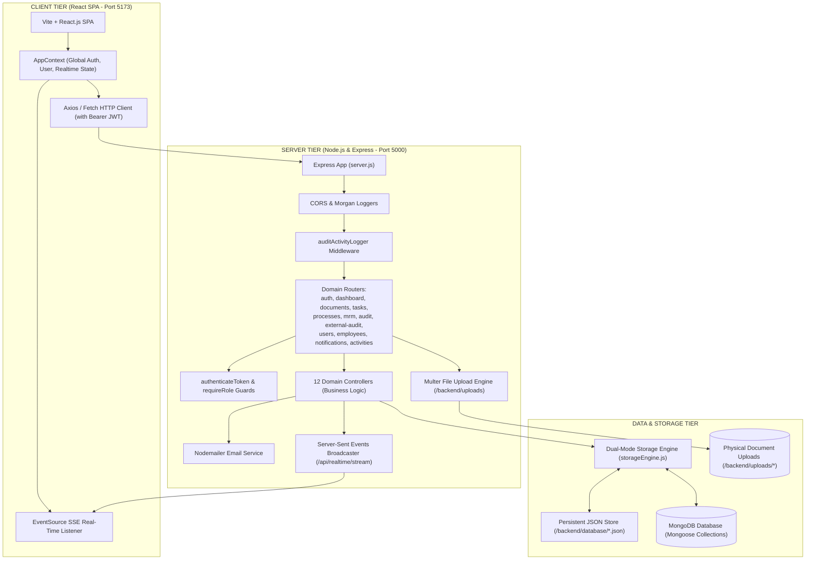
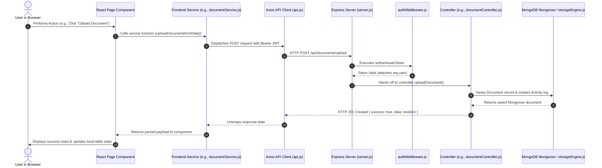
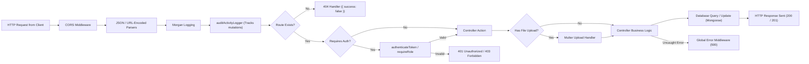
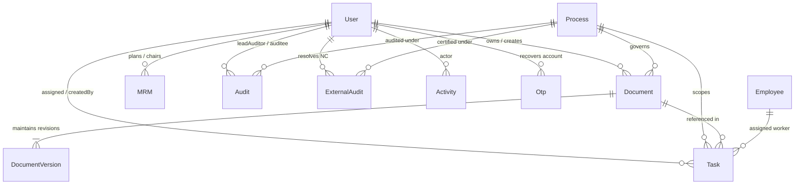
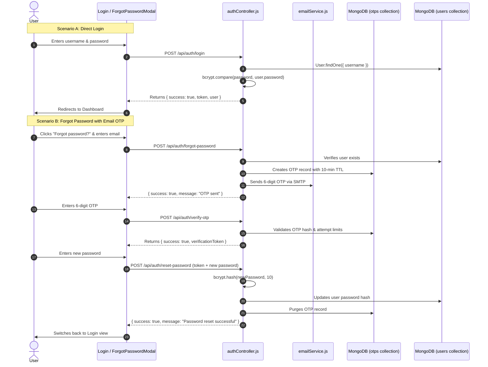
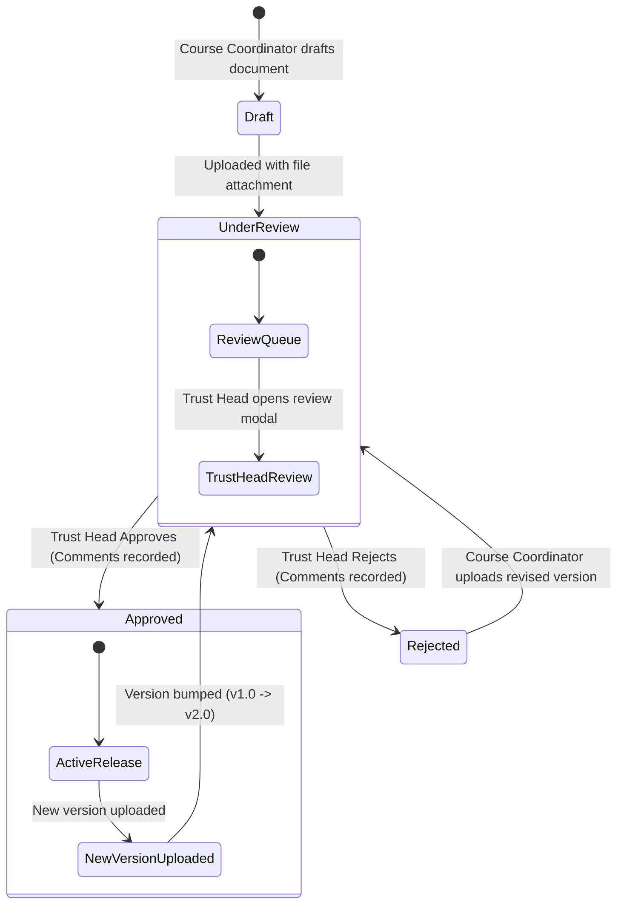
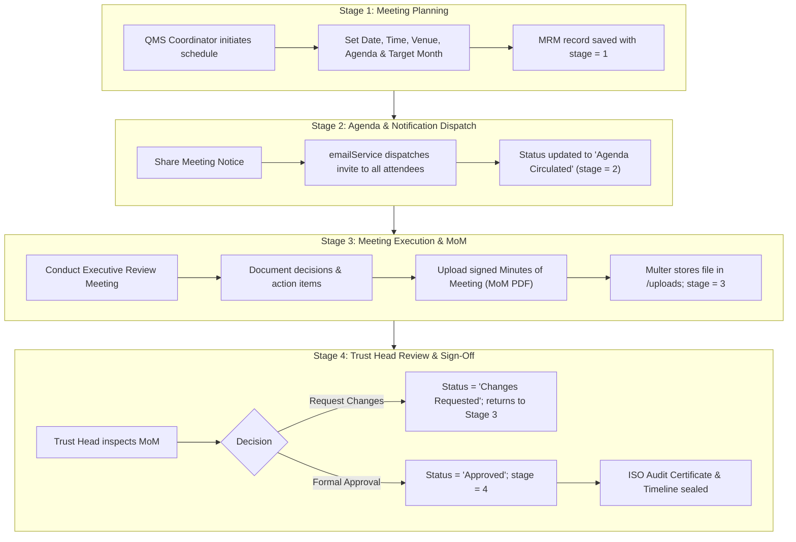
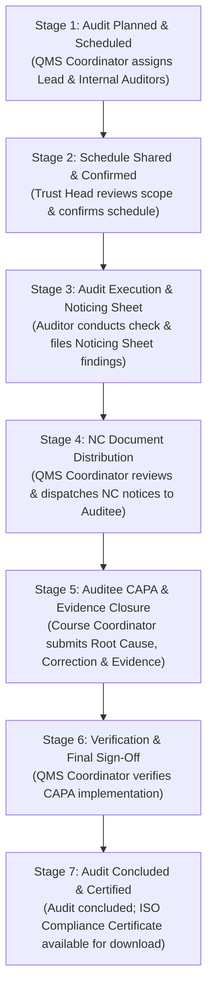
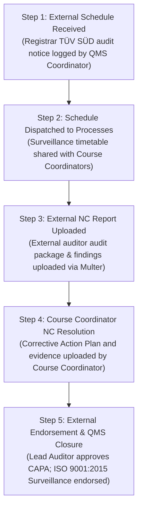

# C-DAC QMS Digitalization - Complete Workflow Diagrams

> **File:** `PROJECT_TECHNICAL_MAP/9. COMPLETE_WORKFLOW_DIAGRAMS.md`  
> **Diagram Format:** Mermaid Standard Markdown Diagrams  
> **Source Fidelity:** Mapped directly to the active C-DAC QMS production codebase.

---

## 1. Overall System Architecture



---

## 2. Frontend Routing Flow

```mermaid
flowchart TD
    BrowserNav["Browser Navigates to URL"] --> MainRouter["BrowserRouter in main.jsx"]
    MainRouter --> AppComp["App.jsx Routes Definition"]
    
    AppComp --> PathCheck{"Target Path"}

    PathCheck -- "/login" --> LoginRoute["Login.jsx"]
    PathCheck -- "/forgot-password" --> ForgotModal["ForgotPasswordModal.jsx"]

    PathCheck -- Protected Routes --> AuthCheck{"Is User Authenticated?"}
    AuthCheck -- No --> RedirectLogin["Navigate to /login (replace: true)"]
    AuthCheck -- Yes --> RoleCheck{"Check ProtectedRoute allowedRoles"}

    RoleCheck -- Not Authorized --> Unauth["Render Access Denied Message"]
    RoleCheck -- Authorized --> DashboardLayout["Render DashboardLayout (Navbar + Sidebar)"]

    DashboardLayout --> ChildRoute{"Resolve Child Component"}
    ChildRoute -- "/" or "/dashboard" --> DashboardView["Dashboard.jsx (Role Adaptive)"]
    ChildRoute -- "/documents" --> DocView["DocumentManagement.jsx"]
    ChildRoute -- "/tasks" --> TaskView["TaskManagement.jsx"]
    ChildRoute -- "/processes" --> ProcView["Processes.jsx"]
    ChildRoute -- "/user-management" --> UserView["UserManagement.jsx"]
    ChildRoute -- "/mrm" --> MRMView["MRMManagement.jsx"]
    ChildRoute -- "/internal-audit" --> IQAView["InternalAudit.jsx"]
    ChildRoute -- "/external-audit" --> ExtAuditView["ExternalAudit.jsx"]
    ChildRoute -- "/version-history" --> AuditTrailView["AuditTrail.jsx"]
    ChildRoute -- "/notifications" --> NotifView["Notifications.jsx"]
```

---

## 3. Frontend to Backend API Flow



---

## 4. Request-Response Lifecycle



---

## 5. Database Entity Relationship Diagram



---

## 6. Authentication & Password Reset Flow (with OTP)



---

## 7. Document Approval Workflow



---

## 8. Management Review Meeting (MRM) 4-Stage Workflow



---

## 9. Internal Quality Audit (IQA) 7-Stage Workflow



---

## 10. External Quality Audit 5-Step Workflow


