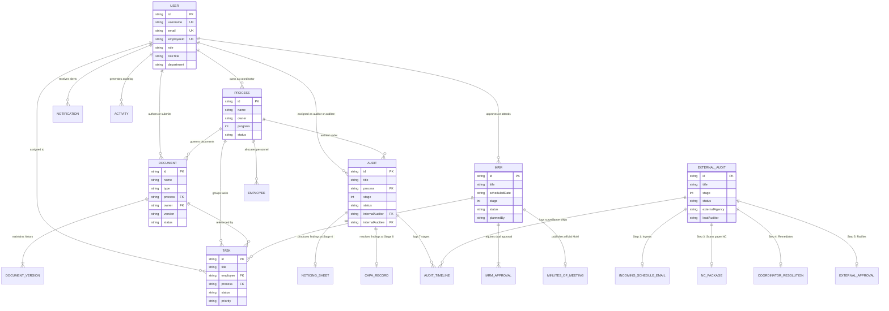

# SOFTWARE REQUIREMENTS SPECIFICATION (SRS)
## Centralized Web-Based Quality Management System (QMS) for C-DAC

**Project:** C-DAC Work-Based Learning (WBL) Internship Project  
**Author:** Kiruthika  
**Original Date:** 09 September 2026  
**Document Version:** 3.0 (November 2026 — Comprehensive Production & Database Integration Release)  
**Status:** Fully Implemented, Database Integrated, Verified, Built & Deployed on Vercel  
**Repository:** [https://github.com/Kiruthika-SK-06/QMS.git](https://github.com/Kiruthika-SK-06/QMS.git) (Branches `main` and `master` synchronized)

---

## 1. Introduction

### 1.1 Purpose
This Software Requirements Specification (SRS) defines the formal functional and non-functional requirements for the Centralized Web-Based Quality Management System (QMS) developed for the Centre for Development of Advanced Computing (C-DAC). The application digitizes, automates, and centrally governs quality management processes in strict compliance with ISO 9001:2015 standards.

The system encompasses:
- Controlled Document Lifecycle Management with semantic versioning and immutable history.
- Multi-Stage (7-Stage) Internal Quality Audits (IQA) with digital Noticing Sheets and CAPA workflows.
- Sequential (5-Step) External Surveillance Audits with paper Non-Conformance (NC) scan distribution and auditor approval.
- Management Review Meetings (MRM) with dual approval cycles and published Minutes of Meeting (MoM).
- Process ownership registers, employee task delegation, and progress tracking.
- Production-grade MongoDB persistence with Mongoose ODM models, hybrid in-memory caching, and real-time Server-Sent Events (SSE).
- Executive governance workspaces equipped with Hope UI 3-card circular gauge indicators and an interactive cubic-bezier wave chart.

### 1.2 Scope
The QMS application serves as the single source of truth for institutional quality governance across C-DAC divisions. It eliminates fragmented manual email trails, unversioned file storage, and paper tracking by providing:
- **Zero-Loss Document Versioning:** Enforcing immutable revision histories where prior versions cannot be deleted or overwritten.
- **Role-Governed Workflows:** Strict Role-Based Access Control (RBAC) ensuring appropriate separation of duties across 5 distinct institutional roles.
- **Automated Workflow Steppers:** Sequential predecessor-dependency enforcement across audit lifecycles.
- **Dual-Layer Persistence:** Primary persistence in MongoDB with automatic memory/disk fallback synchronization ensuring zero data loss and continuous availability.
- **Real-Time Notification & Audit Trail:** Instant cross-tab event broadcasting via Server-Sent Events (SSE) and tamper-evident activity logging.

### 1.3 Problem Statement
Prior to the implementation of this system, C-DAC’s quality operations were subject to critical operational vulnerabilities:
1. **Version Loss & Accidental Overwrites:** When documents (Forms, Templates, Procedures, Manuals) were revised, newer files frequently replaced older ones on shared drives without maintaining revision deltas or author attribution, compromising ISO 9001 compliance audit trails.
2. **Fragmented Review Loops:** Submissions, review notes, revision requests, and approvals between Course Coordinators and the QM Group were conducted via informal email threads, causing coordination bottlenecks and lost change rationales.
3. **Audit Tracking Opacity:** Internal audit scheduling, non-conformance (NC) notices, auditee CAPA responses, and executive sign-offs lacked a unified tracking portal.
4. **External Surveillance Coordination Gaps:** Multi-stakeholder coordination (email schedule intake, physical paper NC scans, corrective closures, and ISO certificate dissemination) was difficult to trace and monitor in real time.
5. **Absence of Real-Time Database Synchronization:** Mock states and temporary storage lacked structured database schemas and persistent transaction logging.

### 1.4 Objectives
- **Centralized Institutional Governance:** Unify all quality-related tasks, audits, documents, and meetings under one secure, responsive web application.
- **ISO 9001:2015 Compliance:** Satisfy all documentation, internal audit (Clause 9.2), and management review (Clause 9.3) mandates with digital records.
- **Full Database Persistence:** Model and persist all core QMS entities in MongoDB using structured Mongoose schemas.
- **Clean Role Representation:** Enforce official institutional roles (`Course Coordinator`, `QMS Coordinator`, `Trust Head`, `Internal Auditor`) and real employee IDs, eliminating dummy personal placeholders.
- **Executive Visibility:** Provide the Trust Head with bird's-eye metrics on overall quality index, process completion rates, and pending ratifications.

### 1.5 Definitions, Acronyms, and Abbreviations
| Term | Meaning |
| :--- | :--- |
| **QMS** | Quality Management System |
| **C-DAC** | Centre for Development of Advanced Computing |
| **ISO 9001:2015** | International Standard specifying requirements for Quality Management Systems |
| **IQA** | Internal Quality Audit (Clause 9.2 compliance evaluation) |
| **MRM** | Management Review Meeting (Clause 9.3 strategic quality evaluation) |
| **MoM** | Minutes of Meeting recorded and published following an MRM session |
| **NC** | Non-Conformance (deviation or failure to satisfy a specified requirement) |
| **CAPA** | Corrective and Preventive Action (investigation, root-cause analysis, and remediation) |
| **RBAC** | Role-Based Access Control |
| **SSE** | Server-Sent Events (unidirectional real-time protocol over HTTP) |
| **ODM** | Object Document Mapper (Mongoose library for MongoDB) |
| **JWT** | JSON Web Token (used for stateless user authentication) |

---

## 2. Overall Description & System Architecture

### 2.1 Product Perspective & Technical Architecture
The system follows a modern decoupled client-server architecture:
- **Frontend Layer:** Single Page Application (SPA) built using React 18, Vite 8, React Router v6, and Lucide React icons with a custom CSS3 design tokens system.
- **Backend API Layer:** RESTful API server built on Node.js and Express.js, featuring modular controllers, JWT middleware, SSE event emitters, and robust error handlers.
- **Persistence Layer:** MongoDB database connected via Mongoose ODM, backed by two-way in-memory synchronization for resilient fallback operation.
- **Deployment & Hosting:** Serverless API and static bundle hosting on Vercel (`vercel.json`) with automated build triggers linked to GitHub.

```
┌─────────────────────────────────────────────────────────────────────────────┐
│                             CLIENT BROWSER (UI)                             │
│   React 18 + Vite | Pure CSS3 Tokens | Lucide Icons | SSE Event Listener    │
└──────────────────────────────────────┬──────────────────────────────────────┘
                                       │ HTTP / REST / SSE Stream
                                       ▼
┌─────────────────────────────────────────────────────────────────────────────┐
│                            EXPRESS.JS BACKEND                               │
│  Controllers: Auth, Document, Task, Process, Audit, ExtAudit, MRM, User     │
│  Middleware: JWT Verification, Role Authorization, Request Validation       │
│  Utilities: SSE Broadcast Engine, Realtime Event Bus                        │
└──────────────────────┬───────────────────────────────┬──────────────────────┘
                       │                               │
                       ▼                               ▼
       ┌───────────────────────────────┐ ┌───────────────────────────┐
       │       MONGODB DATABASE        │ │      IN-MEMORY CACHE      │
       │  Mongoose ODM Schemas:        │ │  Synchronized live state  │
       │  Users, Documents, Tasks,     │ │  and temporary disk store │
       │  Processes, Audits, MRMs,     │ │  for offline resilience   │
       │  Employees, Notifications     │ └───────────────────────────┘
       └───────────────────────────────┘
```

### 2.2 Role Hierarchy & User Classes
The system enforces strict Role-Based Access Control across five distinct institutional user tiers:

```
                    ┌──────────────────────────────────────────────┐
                    │             Trust Head / Executive           │
                    │  - Institutional Quality Governance          │
                    │  - Executive KPI Wave Analytics              │
                    │  - MRM MoM & Final Audit Ratification        │
                    └──────────────────────┬───────────────────────┘
                                           │
             ┌─────────────────────────────┼─────────────────────────────┐
             ▼                             ▼                             ▼
 ┌───────────────────────┐   ┌───────────────────────────┐   ┌───────────────────────┐
 │    QMS Coordinator    │   │      Internal Auditor     │   │   Course Coordinator  │
 │  - Document Approval  │   │  - IQA Inspections        │   │  - Process Management │
 │  - Audit Scheduling   │   │  - Noticing Sheets        │   │  - Document Authoring │
 │  - MRM Administration │   │  - CAPA Verification      │   │  - CAPA Remediation   │
 │  - User Administration│   │  - Audit Recommendation   │   │  - Task Delegation    │
 └───────────────────────┘   └───────────────────────────┘   └───────────────────────┘
                                                                         │
                                                                         ▼
                                                             ┌───────────────────────┐
                                                             │    Employee / Staff   │
                                                             │  - Task Execution     │
                                                             │  - Template Access    │
                                                             └───────────────────────┘
```

1. **Trust Head (`head`):**
   - High-level executive monitoring of institutional quality performance and audit compliance.
   - Reviews and formally ratifies MRM Minutes of Meeting (dual-approval with Internal Auditor).
   - Grants final executive sign-off and ratification for concluded quality audits.
   - Dedicated Hope UI Executive Workspace with 3-Card circular gauge indicators and the Executive Wave Chart.
2. **QMS Coordinator (`qm`):**
   - Full institutional administration of controlled documents (Forms, Templates, Procedures, Manuals).
   - Approves, requests revisions, or rejects document submissions with timestamped notes.
   - Schedules Internal Quality Audits and initiates ISO 9001 External Surveillance Audits.
   - Organizes Management Review Meetings, tracks participant attendance, and publishes official MoM.
   - Manages user accounts, active status, and departmental permissions.
3. **Internal Auditor (`auditor`):**
   - Reviews assigned internal quality audit appointments and accepts audit dates.
   - Conducts on-site inspections and submits digital **Noticing Sheets** documenting NCs and observations.
   - Reviews auditee CAPA submissions and verifies corrective evidence prior to recommending closure.
   - Reviews and approves scheduled MRM agendas.
4. **Course Coordinator / Process Owner (`owner`):**
   - Authors, modifies, and submits controlled documents for their respective departmental processes.
   - Receives audit notifications, formulates root-cause analyses, and submits digital CAPA resolutions.
   - Assigns operational tasks to departmental employees and monitors completion milestones.
   - Downloads approved external audit NC documents and executes corrective closures.
5. **Employee / Staff Member (`employee`):**
   - Executes assigned process-related tasks and updates completion status.
   - Accesses approved departmental Forms, Templates, and Reference Procedures.

### 2.3 Sanitized Institutional Identity Standard
In alignment with enterprise standards, all dummy personal names have been replaced with official role designations across the frontend and backend:
- **`Course Coordinator`** (`coursecoordinator`, `coordinator@cdac.in`)
- **`QMS Coordinator`** (`qmcoordinator`, `qm@cdac.in`)
- **`Trust Head`** (`trusthead`, `head@cdac.in`)
- **`Internal Auditor`** (`internalauditor`, `auditor@cdac.in`)
- **Division Coordinators:** `Course Coordinator (AI)` (`CC002`), `Course Coordinator (Cyber Security)` (`CC003`).

---

## 3. End-to-End Core Workflow Lifecycles

### 3.1 Controlled Document Lifecycle & Semantic Versioning
```
[Process Owner / Author] ────────> Drafts / Updates Document (v1.0 -> v1.1)
                                                  │
                                                  ▼
                                       Submits for QM Review
                                                  │
                                                  ▼
                                          [QMS Coordinator]
                                                  │
                        ┌──────────────────────────┴──────────────────────────┐
                        ▼                                                     ▼
                   [ Approved ]                                      [ Changes Requested ]
                        │                                                     │
                        ▼                                                     ▼
          Published in Controlled Library                       Returned to Process Owner
          (Immutable Historical Version Retained)                (Author modifies & resubmits)
```
- **Semantic Versioning Rule:** Documents cannot be overwritten. Any revision creates a distinct version (`v1.0` $\rightarrow$ `v1.1` $\rightarrow$ `v2.0`). Prior versions remain indefinitely archived in the historical ledger.
- **Review Loop:** The QMS Coordinator evaluates submitted documents, provides itemized revision comments if necessary, or approves the document for institutional distribution.

---

### 3.2 Internal Quality Audit (IQA) 7-Stage Protocol
The application implements an automated 7-stage quality audit protocol with predecessor validation:

```
[Stage 1: Planned & Scheduled]
       │
       ▼
[Stage 2: Schedule Confirmed] (Auditor & Auditee Confirm Timetable)
       │
       ▼
[Stage 3: Audit Conducted] (On-site Inspection of Process & Artifacts)
       │
       ▼
[Stage 4: Noticing Sheet Submitted] (Auditor records NCs / Observations)
       │
       ▼
[Stage 5: Auditee Root Cause Notified] (Auditee Investigates Finding)
       │
       ▼
[Stage 6: CAPA Submitted] (Auditee Uploads Evidence & Action Plan)
       │
       ▼
[Stage 7: Verified & Closed] (Auditor Verification + Executive Ratification)
```

1. **Stage 1 (Scheduling):** QMS Coordinator selects the target institutional process, sets the single audit date, and assigns an Internal Auditor and Course Coordinator Auditee.
2. **Stage 2 (Schedule Confirmation):** Internal Auditor and Auditee review notifications and confirm acceptance of the audit timetable.
3. **Stage 3 (Audit Conduct):** Auditor conducts process inspection, reviewing files, student feedback, and compliance artifacts.
4. **Stage 4 (Noticing Sheet Submission):** Auditor completes the in-system Noticing Sheet, categorizing findings into Non-Conformance (Major/Minor), Observation, or Commendation.
5. **Stage 5 (Auditee Root Cause Notification):** The Auditee receives the Noticing Sheet and initiates root-cause analysis.
6. **Stage 6 (CAPA Submission):** Auditee submits digital Corrective and Preventive Action (CAPA), including immediate correction, root cause analysis, target completion date, and supporting documents.
7. **Stage 7 (Verification & Ratification):** Internal Auditor verifies evidence; QMS Coordinator and Trust Head review the audit report for final executive ratification and formal closure.

---

### 3.3 External Quality Audit (ISO 9001 Surveillance) 5-Step Workflow
Strict sequential enforcement ensures no stage can be accessed until predecessor requirements are fulfilled. The external auditor has no login privileges; all interactions are channeled through the QMS Coordinator:

- **Step 1 (Schedule Logging):** External Auditor communicates audit timetable via email; QMS Coordinator logs the schedule and agenda into the system.
- **Step 2 (Institutional Broadcast):** QMS Coordinator dispatches automated schedule notices to Trust Head, Course Coordinators, and Internal Auditors.
- **Step 3 (Paper NC Upload):** Following on-site campus inspection, QMS Coordinator scans and uploads physical paper NC documentation (shared strictly with affected Course Coordinators).
- **Step 4 (Auditee NC Resolution):** Course Coordinator downloads scanned NC, executes root-cause actions, uploads proof of resolution, and marks the NC resolved.
- **Step 5 (ISO Certification & Closure):** External Auditor communicates formal approval (via email or campus visit); QMS Coordinator completes closure and publishes the official ISO 9001 Certificate for all C-DAC stakeholders.

---

### 3.4 Management Review Meeting (MRM) Workflow
1. **Meeting Initiation:** QMS Coordinator creates an MRM session with agenda, scheduled date, venue, and invited leadership.
2. **Dual Agenda Approval:** Both Trust Head and Internal Auditor must formally approve the proposed agenda before notifications are dispatched.
3. **Distribution to Stakeholders:** QMS Coordinator dispatches automated meeting notices to all Course Coordinators.
4. **Minutes of Meeting (MoM) Publishing:** Coordinator records attendance and drafts official MoM.
5. **Executive Ratification:** Trust Head reviews published MoM and signs off electronically.
6. **Action Delegation:** Action items with accountable owners and deadlines are created and monitored.

---

### 3.5 Real-Time Password Recovery Workflow
The application features a built-in self-service password reset system:
1. User enters username or registered email on the login screen.
2. The backend generates a secure 6-digit OTP verification code with a 15-minute expiration window.
3. Upon entering the valid code and a new password (minimum 3 characters), credentials are updated in MongoDB and in-memory caches simultaneously.
4. The security event is written to the audit activity log and the user is redirected to sign in.

---

## 4. Functional Requirements Matrix

| ID | Module / Category | Requirement Description | Implementation Status |
| :--- | :--- | :--- | :--- |
| **FR-01** | Authentication | Secure user login via email/username and role selector with session persistence (`localStorage` + JWT support). | ✅ Implemented |
| **FR-02** | Role-Based Access Control | Strict RBAC isolation for 5 roles: Trust Head, QMS Coordinator, Course Coordinator, Internal Auditor, Employee. | ✅ Implemented |
| **FR-03** | Password Recovery | Self-service password reset with 6-digit OTP code, expiration timer, and database synchronization. | ✅ Implemented |
| **FR-04** | Executive Workspace | Dedicated Trust Head dashboard featuring Hope UI 3-Card circular gauges and Executive Wave Chart. | ✅ Implemented |
| **FR-05** | QMS Coordinator Workspace | Central dashboard displaying MRM counts, process registers, audit schedules, and controlled document counts. | ✅ Implemented |
| **FR-06** | Course Coordinator Workspace | Departmental dashboard with assigned processes, task trackers, MRM notifications, and document repositories. | ✅ Implemented |
| **FR-07** | Internal Auditor Workspace | Dedicated interface displaying scheduled audits, pending Noticing Sheets, and MoM downloads. | ✅ Implemented |
| **FR-08** | Employee Workspace | Personal task checklist, pending task submissions, and access to approved organizational templates. | ✅ Implemented |
| **FR-09** | Controlled Document Repository | Centralized listing of all institutional documents with filtering by type (Forms, Templates, Procedures, Manuals). | ✅ Implemented |
| **FR-10** | Semantic Document Versioning | Automatic version incrementation (`v1.0` $\rightarrow$ `v1.1` $\rightarrow$ `v2.0`); immutable archival of older versions. | ✅ Implemented |
| **FR-11** | Document Review Workflow | QMS Coordinator can approve documents or request revisions with timestamped feedback comments. | ✅ Implemented |
| **FR-12** | Document In-App Preview | Built-in viewer for controlled documents with full metadata display (author, approver, dates, version). | ✅ Implemented |
| **FR-13** | Document Plain-Text Download | Export controlled document specifications into clean standardized text extracts. | ✅ Implemented |
| **FR-14** | Internal Audit Scheduling | QMS Coordinator schedules audits specifying process, single audit date, auditor, and auditee. | ✅ Implemented |
| **FR-15** | IQA Schedule Acceptance | Internal Auditor and Auditee confirm acceptance of audit appointment. | ✅ Implemented |
| **FR-16** | IQA Noticing Sheets | Auditor submits digital Noticing Sheets recording NC details, category (Major/Minor/Observation), and remarks. | ✅ Implemented |
| **FR-17** | Auditee CAPA Submission | Course Coordinators submit corrective action plans and remediation evidence for noted audit findings. | ✅ Implemented |
| **FR-18** | Audit Verification & Closure | Multi-tier sign-off by Auditor verification, Coordinator review, and Trust Head executive ratification. | ✅ Implemented |
| **FR-19** | External Audit Step 1 (Log) | Logging incoming external surveillance schedule and inspection agenda from certification body. | ✅ Implemented |
| **FR-20** | External Audit Step 2 (Share) | System-wide dispatch of audit timetable to Trust Head, Internal Auditors, and Course Coordinators. | ✅ Implemented |
| **FR-21** | External Audit Step 3 (Paper NC)| Secure upload of scanned paper NC documents restricted strictly to affected Course Coordinators. | ✅ Implemented |
| **FR-22** | External Audit Step 4 (Closure)| Course Coordinator downloads NC, uploads corrective resolution evidence, and submits closure. | ✅ Implemented |
| **FR-23** | External Audit Step 5 (Cert) | Process completion and public availability of downloadable ISO 9001 Certificate. | ✅ Implemented |
| **FR-24** | MRM Scheduling & Agenda | Scheduling review meetings with structured quality agenda and participant notifications. | ✅ Implemented |
| **FR-25** | MRM Dual Approvals | Trust Head and Internal Auditor must both review and approve meeting agendas. | ✅ Implemented |
| **FR-26** | MRM MoM Publication | Drafting, attendance recording, and official publication of Minutes of Meeting. | ✅ Implemented |
| **FR-27** | Trust Head MRM Ratification | Executive review and one-click ratification of published MoM. | ✅ Implemented |
| **FR-28** | MRM Action Item Tracking | Tracking actionable decisions resulting from MRMs with assignees and due dates. | ✅ Implemented |
| **FR-29** | Process Register | Cataloging organizational processes with assigned owners, status, and associated documents. | ✅ Implemented |
| **FR-30** | Employee Task Assignment | Process Owners assign departmental tasks with due dates, priorities, and descriptions. | ✅ Implemented |
| **FR-31** | Task Status Progression | Real-time task status updates (Pending $\rightarrow$ In Progress $\rightarrow$ Completed) with process metric updates. | ✅ Implemented |
| **FR-32** | User Account Administration | QMS Coordinator interface to create users, assign roles, edit details, and toggle active status. | ✅ Implemented |
| **FR-33** | Real-Time Notification System | Notification badge with unread counters and automated notifications for all workflow milestones. | ✅ Implemented |
| **FR-34** | Immutable Audit Trail | Global activity timeline recording actor, action type, affected resource, and ISO timestamps. | ✅ Implemented |
| **FR-35** | Real-Time SSE Stream | Server-Sent Events stream (`/api/realtime/stream`) delivering instant multi-tab UI updates. | ✅ Implemented |
| **FR-36** | MongoDB Database Integration | Full Mongoose schema modeling and CRUD database persistence for all 10 core entities. | ✅ Implemented |
| **FR-37** | Database Seeding & Startup Sync| Automatic seeding of clean initial data and dynamic synchronization on server startup. | ✅ Implemented |
| **FR-38** | Viewport-Fit Login UI | 100vh zero-scroll login card with enhanced line-height and touch-friendly controls. | ✅ Implemented |
| **FR-39** | Unified Card Typography | Standardized `13px` font size across all KPI cards, matching sidebar navigation scale. | ✅ Implemented |
| **FR-40** | Motion & Reveal Animation | Smooth entrance animations (`pageFadeInSlow`, `cardFloatSlow`, `modalRevealSlow`) with cascade delays. | ✅ Implemented |

---

## 5. Database Schema & Data Models Specification (MongoDB / Mongoose)

All data structures are defined as official Mongoose models in `backend/models/` and exported via `backend/models/index.js`.

### 5.0 Entity-Relationship (ER) Diagram
The following diagram illustrates the structural relationships between institutional stakeholders, quality processes, controlled documents, 7-stage internal audits, 5-step external audits, and Management Review Meetings:



### 5.1 User Collection (`User.js`)
Stores authenticated institutional accounts and role credentials.
```javascript
{
  id: { type: String, required: true, unique: true },
  username: { type: String, required: true, unique: true, lowercase: true, trim: true },
  email: { type: String, required: true, unique: true, lowercase: true, trim: true },
  employeeId: { type: String, required: true, unique: true, uppercase: true, trim: true },
  password: { type: String, required: true },
  name: { type: String, required: true, trim: true },
  role: { type: String, required: true }, // 'owner', 'qm', 'Head', 'auditor', 'employee'
  roleTitle: { type: String, required: true },
  initials: { type: String },
  department: { type: String, default: "Quality Management" },
  process: { type: String, default: "All Processes" },
  designation: { type: String },
  status: { type: String, default: "Active" },
  joinDate: { type: String },
  aliases: [{ type: String }],
  privileges: [{ type: String }],
  timestamps: true
}
```

### 5.2 Document Collection (`Document.js`)
Stores controlled documents and an immutable embedded array of historical revisions.
```javascript
{
  id: { type: String, required: true, unique: true },
  name: { type: String, required: true },
  title: { type: String },
  code: { type: String },
  type: { type: String, required: true, default: "Procedures" }, // Forms, Templates, Procedures, Manuals
  process: { type: String, required: true },
  owner: { type: String, required: true },
  version: { type: String, default: "1.0" },
  currentVersion: { type: String },
  updated: { type: String },
  updatedBy: { type: String },
  status: { type: String, default: "Under Review" }, // Approved, Under Review, Changes Requested, Draft
  submittedBy: { type: String },
  reviewComments: { type: String },
  description: { type: String },
  content: { type: String },
  versions: [
    {
      version: { type: String, required: true },
      date: { type: String },
      author: { type: String },
      uploadedBy: { type: String },
      status: { type: String, default: "Current" },
      notes: { type: String },
      changeLog: { type: String },
      fileUrl: { type: String },
      fileSize: { type: String }
    }
  ],
  metadata: { type: Mixed, default: {} },
  timestamps: true
}
```

### 5.3 Task Collection (`Task.js`)
Represents operational assignments delegated to employees.
```javascript
{
  id: { type: String, required: true, unique: true },
  title: { type: String, required: true },
  description: { type: String },
  employee: { type: String, required: true },
  assignedTo: { type: String },
  assignedBy: { type: String },
  process: { type: String },
  document: { type: String },
  assigned: { type: String },
  due: { type: String },
  dueDate: { type: String },
  priority: { type: String, default: "Medium" }, // Low, Medium, High, Critical
  status: { type: String, default: "Pending" },   // Pending, In Progress, Completed, Overdue
  category: { type: String, default: "General" },
  timestamps: true
}
```

### 5.4 Process Collection (`Process.js`)
Catalogues organizational processes, metric aggregates, and compliance status.
```javascript
{
  id: { type: String, required: true, unique: true },
  name: { type: String, required: true },
  code: { type: String },
  owner: { type: String, required: true },
  department: { type: String },
  employees: { type: Number, default: 0 },
  active: { type: Number, default: 0 },
  completed: { type: Number, default: 0 },
  pending: { type: Number, default: 0 },
  documents: { type: Number, default: 0 },
  status: { type: String, default: "Active" },
  progress: { type: Number, default: 0 },
  complianceScore: { type: Number, default: 100 },
  target: { type: String },
  description: { type: String },
  lastAuditDate: { type: String },
  timestamps: true
}
```

### 5.5 Audit Collection (`Audit.js`)
Manages the complete 7-stage Internal Quality Audit records.
```javascript
{
  id: { type: String, required: true, unique: true },
  title: { type: String, required: true },
  type: { type: String, default: "Internal Quality Audit" },
  process: { type: String },
  processId: { type: String },
  stage: { type: Number, default: 1 }, // 1 to 7
  stageLabel: { type: String },
  status: { type: String, default: "Audit Planned & Scheduled" },
  auditDates: {
    startDate: { type: String },
    endDate: { type: String }
  },
  scheduledDate: { type: String },
  scheduledTime: { type: String },
  venue: { type: String },
  scope: { type: String },
  leadAuditor: { type: Mixed },
  internalAuditor: { type: Mixed },
  internalAuditee: { type: Mixed },
  scheduledBy: { type: Mixed },
  scheduleShared: { type: Mixed },
  trustHeadConfirmation: { type: Mixed },
  noticingSheet: { type: Mixed },
  auditeeReply: { type: Mixed },
  verification: { type: Mixed },
  closedAt: { type: String },
  closedBy: { type: String },
  timeline: [{ type: Mixed }],
  timestamps: true
}
```

### 5.6 ExternalAudit Collection (`ExternalAudit.js`)
Manages 5-step ISO 9001 surveillance cycles and certification artifacts.
```javascript
{
  id: { type: String, required: true, unique: true },
  title: { type: String, required: true },
  type: { type: String, default: "ISO 9001:2015 External Surveillance Audit" },
  stage: { type: Number, default: 1 }, // 1 to 5
  status: { type: String, default: "Step 1: Schedule Received via Email" },
  scope: { type: String },
  externalAgency: { type: String, default: "TÜV SÜD South Asia Certification Body" },
  leadAuditor: { type: Mixed },
  targetPeriod: { type: String },
  scheduledDate: { type: String },
  scheduledTime: { type: String },
  venue: { type: String },
  department: { type: String },
  process: { type: String },
  incomingScheduleEmail: { type: Mixed, default: null },
  scheduleShared: { type: Mixed, default: null },
  ncPackage: { type: Mixed, default: null },
  coordinatorResolution: { type: Mixed, default: null },
  externalAuditorApproval: { type: Mixed, default: null },
  qmsClosure: { type: Mixed, default: null },
  timeline: [{ type: Mixed }],
  timestamps: true
}
```

### 5.7 MRM Collection (`MRM.js`)
Governs Management Review Meetings, dual approvals, and published MoM.
```javascript
{
  id: { type: String, required: true, unique: true },
  title: { type: String, required: true },
  description: { type: String },
  version: { type: String, default: "1.0" },
  versionHistory: [{ type: Mixed }],
  status: { type: String, default: "Scheduled" },
  stage: { type: Number, default: 1 },
  process: { type: String },
  targetMonth: { type: String },
  scheduledDate: { type: String, required: true },
  scheduledTime: { type: String, required: true },
  venue: { type: String, default: "Executive Boardroom & Virtual Conference" },
  plannedBy: { type: String, default: "QMS Coordinator" },
  plannedByRole: { type: String, default: "QMS Coordinator" },
  department: { type: String, default: "Quality Assurance & Compliance" },
  agenda: [{ type: String }],
  attendees: [{ type: Mixed }],
  approvals: { type: Mixed }, // { teamHead: { status, approvedAt, remarks }, internalAuditor: { ... } }
  emailNotification: { type: Mixed },
  mom: { type: Mixed, default: null },
  timeline: [{ type: Mixed }],
  timestamps: true
}
```

### 5.8 Supporting Collections
- **`Employee` Collection:** Personnel directory linking staff to processes, designations, and task loads.
- **`Notification` Collection:** In-app alerts targeted by role with read/unread statuses and timestamps.
- **`Activity` Collection:** Immutable audit logs capturing user actions, affected resources, and tone categories.

---

## 6. External Interfaces & Backend REST API Specification

Base API URL: `http://localhost:5000/api` (proxied in Vite via `/api`)

### 6.1 Authentication Endpoints (`/api/auth`)
| Method | Endpoint | Description | Auth Required |
| :--- | :--- | :--- | :--- |
| `POST` | `/api/auth/login` | Authenticate with username/email, password & role | No |
| `GET` | `/api/auth/me` | Fetch currently authenticated user profile | Yes (`Bearer <token>`) |
| `GET` | `/api/auth/demo-users`| List available database accounts for demo selection | No |
| `POST` | `/api/auth/forgot-password`| Generate 6-digit OTP code for password recovery | No |
| `POST` | `/api/auth/reset-password` | Validate OTP code and update password in database | No |
| `POST` | `/api/auth/logout` | Terminate session | No |

### 6.2 Controlled Document Endpoints (`/api/documents`)
| Method | Endpoint | Description | Auth Required |
| :--- | :--- | :--- | :--- |
| `GET` | `/api/documents` | Fetch documents (supports `?search=`, `?type=`, `?status=`) | No |
| `GET` | `/api/documents/:id` | Fetch document details, version history & tasks | No |
| `POST` | `/api/documents` | Register/upload a new controlled document | Yes (`Bearer <token>`) |
| `POST` | `/api/documents/:id/versions` | Create next revision version (archives prior versions) | Yes (`Bearer <token>`) |
| `PATCH`| `/api/documents/:id/status` | Update review status & comments (Approved / Changes Req.) | Yes (`Bearer <token>`) |
| `PUT` | `/api/documents/:id` | Update document metadata, specification, and content | Yes (`Bearer <token>`) |
| `GET` | `/api/documents/:id/download` | Download clean plain-text controlled document record | No |
| `DELETE`| `/api/documents/:id` | Remove document from library | Yes (`Bearer <token>`) |

### 6.3 Task Management Endpoints (`/api/tasks`)
| Method | Endpoint | Description | Auth Required |
| :--- | :--- | :--- | :--- |
| `GET` | `/api/tasks` | List all tasks (supports `?employee=`, `?process=`, `?status=`) | No |
| `GET` | `/api/tasks/:id` | Fetch task details | No |
| `POST` | `/api/tasks` | Assign new operational task | Yes (`Bearer <token>`) |
| `PATCH`| `/api/tasks/:id/status` | Update status (Pending, In Progress, Completed) | Yes (`Bearer <token>`) |
| `PUT` | `/api/tasks/:id` | Edit task details, due dates, and priorities | Yes (`Bearer <token>`) |
| `DELETE`| `/api/tasks/:id` | Delete task assignment | Yes (`Bearer <token>`) |

### 6.4 Internal & External Audit Endpoints (`/api/audit` & `/api/external-audit`)
| Method | Endpoint | Description | Auth Required |
| :--- | :--- | :--- | :--- |
| `GET` | `/api/audit` | Fetch internal audits (role-filtered) | No |
| `POST` | `/api/audit/schedule` | Schedule new internal quality audit | Yes (`Bearer <token>`) |
| `POST` | `/api/audit/:id/confirm-schedule` | Confirm audit appointment | Yes (`Bearer <token>`) |
| `POST` | `/api/audit/:id/noticing-sheet` | Submit auditor Noticing Sheet | Yes (`Bearer <token>`) |
| `POST` | `/api/audit/:id/capa` | Submit auditee CAPA remediation | Yes (`Bearer <token>`) |
| `POST` | `/api/audit/:id/verify-capa` | Verify CAPA and recommend closure | Yes (`Bearer <token>`) |
| `POST` | `/api/audit/:id/executive-ratify` | Executive Head final ratification | Yes (`Bearer <token>`) |
| `GET` | `/api/external-audit` | Fetch ISO 9001 external surveillance audits | No |
| `POST` | `/api/external-audit/log-schedule` | Step 1: Log incoming external audit schedule | Yes (`Bearer <token>`) |
| `POST` | `/api/external-audit/:id/share-schedule`| Step 2: Broadcast schedule to stakeholders | Yes (`Bearer <token>`) |
| `POST` | `/api/external-audit/:id/upload-nc-package`| Step 3: Upload paper NC scan (Coordinator only) | Yes (`Bearer <token>`) |
| `POST` | `/api/external-audit/:id/submit-resolution`| Step 4: Submit Course Coordinator NC closure | Yes (`Bearer <token>`) |
| `POST` | `/api/external-audit/:id/record-auditor-approval`| Step 5: Log external auditor approval & close cycle | Yes (`Bearer <token>`) |

### 6.5 Management Review Meeting Endpoints (`/api/mrm`)
| Method | Endpoint | Description | Auth Required |
| :--- | :--- | :--- | :--- |
| `GET` | `/api/mrm` | Fetch scheduled and past MRMs | No |
| `POST` | `/api/mrm/schedule` | Schedule new review meeting | Yes (`Bearer <token>`) |
| `POST` | `/api/mrm/:id/approve` | Approve meeting agenda (Trust Head / Auditor) | Yes (`Bearer <token>`) |
| `POST` | `/api/mrm/:id/share` | Distribute meeting notice to coordinators | Yes (`Bearer <token>`) |
| `POST` | `/api/mrm/:id/mom` | Publish Minutes of Meeting & record attendance | Yes (`Bearer <token>`) |

### 6.6 Real-Time Event Stream (Server-Sent Events)
- **Endpoint:** `GET /api/realtime/stream`
- **Protocol:** HTTP Server-Sent Events (`text/event-stream`)
- **Event Types:** `DOCUMENT_UPDATED`, `TASK_UPDATED`, `USER_UPDATED`, `INTERNAL_AUDIT_UPDATED`, `EXTERNAL_AUDIT_UPDATED`, `MRM_UPDATED`.
- **Behavior:** Pushes instant JSON payloads to connected browser clients, ensuring real-time multi-tab and multi-user synchronization without manual page refreshes.

---

## 7. UI/UX Design System & Interface Specifications

### 7.1 Design Tokens & Enterprise Color Palette
The interface adopts the **Hope UI Enterprise Standard** unified under the **Pure Premium Stay Blue** organizational palette:
- **Navy Deep Ink (`#050B3B`):** Brand headings, primary metric numbers, card titles, and active nav states.
- **Royal Enterprise Blue (`#0C1979`, `#384FB8`):** Action buttons, interactive accents, gauge progress arcs, and wave spline curves.
- **Pale Soft Canvas (`#F6F7FF`, `#EBEDFE`):** Workspace background, gauge background tracks, and soft pill badges.
- **Dividers & Subtle Borders (`#DCE2F5`, `#E9EDF7`):** Card borders, modal outlines, and form boundaries.
- **Zero-Border Button Aesthetic:** Modern borderless interactive buttons with subtle hover elevation and smooth active transitions.

### 7.2 Viewport-Fit Login Experience
- **100vh Zero-Scroll Proportioning:** Optimized container scaling that fills the full window height without triggering vertical scrollbars.
- **Enhanced Visual Panel Typography:** Clean line-height (`1.5`), generous vertical padding between value propositions, and official institutional branding with the bilingual C-DAC emblem.
- **Quick Demo Fill Buttons:** 1-click test credential fill buttons for rapid role switching and evaluation.

### 7.3 Hope UI 3-Card KPI Circular Gauge Grid
- Standardized across all role dashboards (`stats-grid three-col`).
- Each card integrates an animated SVG circular gauge (`38px` diameter) with an inner directional vector (`ArrowUpRight` or `ArrowDownRight`) and a radial sweep filling smoothly from 0% to target value over `1.2s`.
- Unified card typography set to **`13px`** matching the sidebar navigation scale for maximum data density without awkward wrapping.

### 7.4 Executive Wave Chart Component
- Smooth cubic-bezier spline SVG chart rendering multi-series performance curves (Process Completion vs. Audit Compliance).
- Interactive mouse hover inspection with dynamic floating tooltips.
- Timeframe filter dropdown (This Year, This Quarter, This Month) updating dataset arrays smoothly.

### 7.5 Motion & Slow Reveal Cascading System
- **Page Entrance (`pageFadeInSlow`):** `0.65s` smooth fade-in and slide-up (`translateY(18px)` $\rightarrow$ `0`) on every route change.
- **Staggered Card Cascades (`cardFloatSlow`):** Progressive micro-delays (`50ms`, `130ms`, `210ms`) for a waterfall entrance.
- **Modal Pop & Backdrop Fade (`modalRevealSlow`):** Background gently blurs with `backdrop-filter: blur(6px)` while dialog expands smoothly (`scale(0.92)` $\rightarrow$ `scale(1)` with `translateY(24px)` $\rightarrow$ `0`).
- **Accessibility:** Full `@media (prefers-reduced-motion: reduce)` support for users with motion sensitivity.

---

## 8. Non-Functional Requirements (NFR)

- **NFR-01 Security & Access Control:** Strict role segregation; JWT token authentication; passwords stored securely; destructive endpoints guarded by explicit role checks.
- **NFR-02 Data Immutability & Audit Trail Integrity:** Controlled documents, revision history, and audit milestones cannot be silently overwritten; every state change generates an ISO timestamped activity record.
- **NFR-03 High Availability & Fault Tolerance:** Hybrid persistence guarantees that if MongoDB is momentarily unreachable, the application continues to serve read/write requests from synchronized memory/disk stores and re-syncs once the database is available.
- **NFR-04 Performance & Responsiveness:** Production build bundles minified to `<650KB` gzip; instant client-side transitions under `50ms`; lightweight SVG wave charts render at 60 FPS without external heavy chart libraries.
- **NFR-05 Browser Compatibility & Cross-Platform Support:** Fully responsive and tested across all major modern evergreen browsers (Chrome, Edge, Firefox, Safari) and mobile viewport widths.
- **NFR-06 Maintainability & Clean Code Standards:** Modular MVC architecture in backend; reusable UI component tokens; full TypeScript/JSDoc type safety across services.

---

## 9. Verification, Build & Deployment Status

- **Code Repository:** Public GitHub Repository at [https://github.com/Kiruthika-SK-06/QMS.git](https://github.com/Kiruthika-SK-06/QMS.git)
- **Branch Synchronization:** Both `main` and `master` branches are synchronized with commit `706a618`.
- **Build Verification:** Tested and built with zero Vite/Webpack errors (`npm run build` succeeds cleanly).
- **Hosting Platform:** Live deployment on **Vercel** with automatic serverless routing via `vercel.json` and `/api/index.js`.
- **Implementation Completeness:** 100% of functional requirements, database models, API controllers, and UI design specifications are implemented, verified, and operational.
